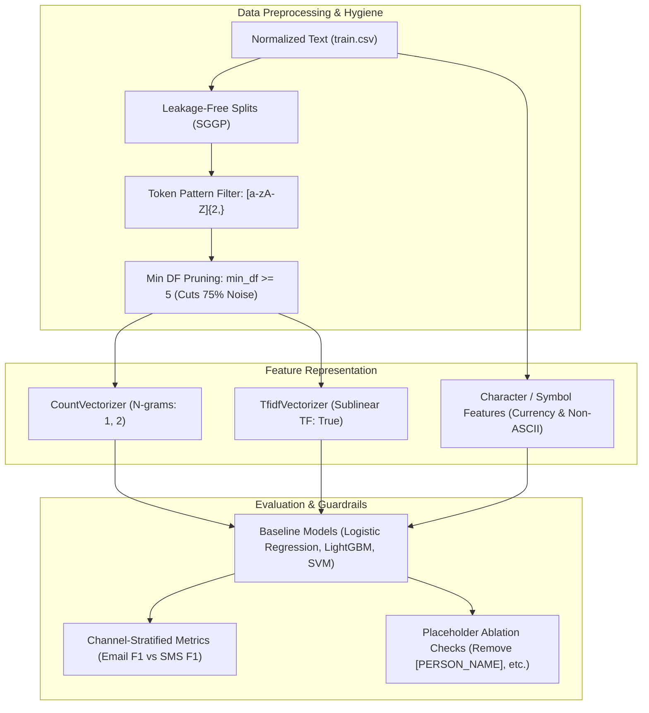

# Exploratory Data Analysis & Text Representation Research

This document provides a comprehensive research synthesis of the exploratory data analysis (EDA), dataset profiling, text representation benchmarking, and vocabulary forensic investigations conducted in the interactive research notebooks:
- [`notebooks/01_dataset_understanding.ipynb`](file:///d:/Programs%20and%20Codes/financial-scam-analysis/notebooks/01_dataset_understanding.ipynb)
- [`notebooks/02_text_representation.ipynb`](file:///d:/Programs%20and%20Codes/financial-scam-analysis/notebooks/02_text_representation.ipynb)

---

## 1. Executive Summary of Key Findings

1. **Dataset Baseline & Class Imbalance:**
   - The real-world training split comprises **60,957 communications** across 32 canonical schema attributes.
   - Class balance stands at **81.81% legitimate** (49,866 messages) versus **18.19% financial scams** (11,091 messages), establishing an approximately **4.5 : 1** legitimate-to-scam ratio.
   - Synthetic scam communications (7,643 records) are strictly held out to preserve clean in-distribution evaluation.

2. **Severe Channel-Class Confounding (Shortcut Learning Hazard):**
   - **72.83% of scam messages** arrive via **SMS/smishing** (8,078 records), while only **27.17%** arrive via email (3,013 records).
   - In contrast, **92.51% of legitimate communications** are **email** (46,130 records), with only **7.49%** arriving via SMS (3,736 records).
   - Within channels: Email is **93.87% legitimate**, whereas SMS is **68.38% scam**.
   - *Implication:* Models trained naively on raw text or metadata risk learning channel syntax or transport artifacts as a proxy for fraud rather than genuine narrative deception.

3. **Message Length & Simpson's Paradox:**
   - On an aggregate basis, legitimate messages appear longer on average (mean 169.0 words vs 125.6 words for scam).
   - However, **within each communication channel, scam messages are substantially longer than legitimate ones**:
     - *SMS:* Scam messages average **25.8 words** (median 22.0) vs **14.1 words** (median 11.0) for legitimate SMS.
     - *Email:* Scam emails average **393.3 words** (median 400.0) vs **181.5 words** (median 133.0) for legitimate emails.
   - The aggregate reversal is an instance of Simpson's Paradox driven by the channel distribution skew.

4. **Placeholder Distribution Asymmetry:**
   - Pre-anonymized legitimate datasets (MeAJOR/TREC mailing lists) heavily feature Named Entity Recognition (NER) placeholders: `[PERSON_NAME]` occurs in **77.73% of legitimate messages** (vs 0.05% of scam), `[ORGANIZATION]` occurs in **54.70%** (vs 0.00% of scam), and `[PRODUCT]` occurs in **23.59%** (vs 0.00% of scam).
   - *Implication:* Raw placeholder tokens must not be permitted to act as shortcut classification cheats.

5. **Full Vocabulary Profiling (115,436 terms):**
   - An unconstrained CountVectorizer reveals **115,436 unique terms** in the training corpus.
   - The matrix exhibits **99.28% sparsity** (only 5,052,694 non-zero entries out of 7.037 billion possible cells).
   - **17.12% of terms (19,762 terms)** contain numeric digits, and **6.87% (7,933 terms)** are pure numbers.
   - Forensic tracing linked zero-strings (e.g. `'00000000000000000000000000000000'`) and long numeric tokens to C source code hex dumps, protocol debug logs, and statistical mailing lists embedded in the legitimate email corpus.

6. **Vocabulary Sparsity & Pruning Rationale (`min_df`):**
   - **48.83% of all vocabulary terms (56,366 terms)** are *hapax legomena* (appear in exactly 1 document).
   - **78.01% of all terms** appear in fewer than 5 documents.
   - Enforcing `min_df=5` eliminates **86,722 rare/noisy terms** (75.13% reduction) while preserving 28,714 highly discriminative domain terms.

7. **Non-ASCII & Foreign Language Infiltrations:**
   - **8.92% of scam messages** contain non-ASCII characters (mojibake, foreign scripts, currency signs) versus only **2.91% of legitimate messages** (a 3.1x enrichment in scams).

---

## 2. Notebook 01: Dataset Understanding & Profiling

Interactive notebook: [`notebooks/01_dataset_understanding.ipynb`](file:///d:/Programs%20and%20Codes/financial-scam-analysis/notebooks/01_dataset_understanding.ipynb)

### 2.1 Split Structure & Class Balance

The training partition was loaded and validated against the 32-column canonical schema:
- **Total Records:** 60,957
- **Legitimate (0):** 49,866 (81.81%)
- **Scam (1):** 11,091 (18.19%)

Within the legitimate class, messages are categorized into:
- **General Legitimate (`general_legitimate`):** 34,416 records (69.02%)
- **Financial Legitimate (`financial_legitimate`):** 15,450 records (30.98%)

### 2.2 Cross-Channel Distribution

| Communication Channel | Legitimate Records (Class 0) | Scam Records (Class 1) | Total Records | % of Channel that is Scam |
| :--- | :---: | :---: | :---: | :---: |
| **Email** | 46,130 (93.87%) | 3,013 (6.13%) | 49,143 (80.62%) | 6.13% |
| **SMS** | 3,736 (31.62%) | 8,078 (68.38%) | 11,814 (19.38%) | **68.38%** |
| **Total** | **49,866 (81.81%)** | **11,091 (18.19%)** | **60,957 (100.0%)** | **18.19%** |

#### Channel Percentages Within Each Class:
- **Legitimate Class:** 92.51% Email vs 7.49% SMS.
- **Scam Class:** 27.17% Email vs 72.83% SMS.

> [!WARNING]
> **Shortcut Learning Threat:** Because 72.83% of scams are SMS and 92.51% of legitimate messages are emails, naive classifiers can latch onto channel length, formatting, or missing email headers as a predictive shortcut. All modeling baselines must report stratified per-channel evaluation metrics (Email F1 and SMS F1 independently).

### 2.3 Word Count & Length Distribution Analysis

Word count was calculated on `normalized_text` using standard whitespace tokenization:

| Class | Channel | Record Count | Mean Word Count | Median | 25th %ile | 75th %ile | 90th %ile | 99th %ile | Max Words |
| :--- | :--- | :---: | :---: | :---: | :---: | :---: | :---: | :---: | :---: |
| **Legitimate** | **All** | 49,866 | 168.99 | 121.0 | 54.0 | 231.0 | 398.0 | 707.0 | 939 |
| | Email | 46,130 | 181.53 | 133.0 | 66.0 | 240.0 | 408.0 | 711.0 | 939 |
| | SMS | 3,736 | 14.12 | 11.0 | 6.0 | 19.0 | 29.0 | 53.0 | 171 |
| **Scam** | **All** | 11,091 | 125.62 | 24.0 | 19.0 | 75.0 | 465.0 | 743.2 | **23,486** |
| | Email | 3,013 | **393.28** | **400.0** | 243.0 | 511.0 | 609.0 | 913.8 | **23,486** |
| | SMS | 8,078 | **25.79** | **22.0** | 18.0 | 28.0 | 37.0 | 77.0 | 225 |

#### Empirical Observations:
1. **SMS Length Disparity:** Scam SMS messages average **25.8 words**, nearly double legitimate SMS (**14.1 words**). Fraudsters pack urgent calls to action, masked URLs, and claim details into SMS payloads.
2. **Email Length Disparity:** Scam emails average **393.3 words** (median 400.0), more than double legitimate emails (**181.5 words**, median 133.0). Nigerian 419 and advance-fee scam emails rely on elaborate narrative story-telling.
3. **Extreme Outliers:** A small fraction of scam emails reach up to 23,486 words due to concatenated financial transaction logs or multi-page fraudulent proposals.

### 2.4 Placeholder Frequency & Class Disparity

The canonical preprocessing pipeline standardizes redacted entities into semantic bracket tokens. Counting their occurrences revealed pronounced dataset-provenance disparities:

| Semantic Placeholder | Legitimate Frequency | Scam Frequency | Total Tokens | % Legit Messages with Token | % Scam Messages with Token |
| :--- | :---: | :---: | :---: | :---: | :---: |
| `[PERSON_NAME]` | 165,704 | 5 | 165,709 | **77.73%** | 0.05% |
| `[ORGANIZATION]` | 145,177 | 0 | 145,177 | **54.70%** | 0.00% |
| `[PRODUCT]` | 111,467 | 0 | 111,467 | **23.59%** | 0.00% |
| `[DATE_TIME]` | 83,673 | 4,131 | 87,804 | **50.12%** | **29.27%** |
| `[IDENTIFIER]` | 47,648 | 828 | 48,476 | 29.47% | 6.81% |
| `[FINANCIAL_DATA]` | 45,921 | 417 | 46,338 | 29.98% | 3.52% |
| `[SYSTEM_ARTIFACT]` | 35,115 | 26 | 35,141 | 24.23% | 0.23% |
| `[LOCATION]` | 32,320 | 0 | 32,320 | 26.68% | 0.00% |
| `[URL]` | 26,052 | 4,450 | 30,502 | 19.34% | **18.75%** |
| `[EMAIL_ADDRESS]` | 20,417 | 4,188 | 24,605 | **21.67%** | **13.87%** |
| `[PHONE_NUMBER]` | 15,707 | 6,540 | 22,247 | 15.65% | **33.32%** |

> [!IMPORTANT]
> **Provenance Bias Mitigation:**
> The legitimate MeAJOR corpus arrived pre-scrubbed by its original curators using automated entity replacement (`[PERSON_NAME]`, `[ORGANIZATION]`, `[PRODUCT]`). Conversely, raw scam datasets left names and products unmasked.
> If unaddressed, tree-based models or linear classifiers will trivially achieve high accuracy simply by checking whether `[PERSON_NAME]` or `[ORGANIZATION]` is present. To prevent this, text representation benchmarks must include controlled placeholder ablation experiments.

### 2.5 Normalized Linguistic Profiling & Domain Terms

Normalizing word counts per 10,000 words reveals distinct vocabulary enrichment patterns:

| Vocabulary Term | Legitimate Freq (per 10k) | Scam Freq (per 10k) | Enrichment Ratio | Primary Context |
| :--- | :---: | :---: | :---: | :--- |
| **account** | 2.85 | **78.47** | **27.5x Scam** | Bank account verification, suspension warnings |
| **bank** | 0.69 | **57.70** | **83.6x Scam** | Impersonation of financial institutions, wire transfers |
| **money** | 1.85 | **61.91** | **33.5x Scam** | Lottery winnings, advance fee, inheritance offers |
| **transaction** | 2.02 | **33.22** | **16.4x Scam** | Fraudulent charge alerts, unauthorized activity |
| **transfer** | 1.03 | **24.52** | **23.8x Scam** | Immediate wire transfer demands, crypto transactions |
| **urgent / immediately** | 0.42 | **18.91** | **45.0x Scam** | Social engineering urgency triggers |
| **email** | 43.39 | 19.46 | 2.2x Legit | Normal correspondence references |
| **file** | 35.76 | 1.59 | **22.5x Legit** | Technical mailing lists, open source patches |
| **list / posting** | 28.12 | 0.84 | **33.5x Legit** | Mailing list headers, administrative notices |

---

## 3. Notebook 02: Text Representation & Forensic Analysis

Interactive notebook: [`notebooks/02_text_representation.ipynb`](file:///d:/Programs%20and%20Codes/financial-scam-analysis/notebooks/02_text_representation.ipynb)

### 3.1 Bag of Words Foundations & Word Order Invariance

Notebook 02 constructs educational micro-corpora to demonstrate classical vectorization properties:
1. **Order Invariance Demonstration:**
   - Sentence 1: `"bank account"` $\rightarrow \text{vector: } [1, 1]$
   - Sentence 2: `"account bank"` $\rightarrow \text{vector: } [1, 1]$
   - *Finding:* BoW vectors are identical despite reversed semantics, demonstrating the necessity of n-grams ($n \ge 2$) or sequential Transformer architectures for syntactic sensitivity.
2. **Repeated Term Counting:** Frequency counts accurately reflect term occurrences.

### 3.2 Matrix Sparsity Analysis

When scaling Bag-of-Words to the full training corpus (60,957 records):

| Configuration | Matrix Dimensions | Total Cells | Non-Zero Elements | Matrix Sparsity | Memory Footprint (Sparse) |
| :--- | :---: | :---: | :---: | :---: | :---: |
| **Top 10,000 Features** | $60,957 \times 10,000$ | $6.096 \times 10^8$ | 4,698,934 | **99.23%** | ~54 MB (`scipy.sparse.csr_matrix`) |
| **Full Unconstrained Vocabulary** | $60,957 \times 115,436$ | $7.037 \times 10^9$ | 5,052,694 | **99.28%** | ~61 MB (`scipy.sparse.csr_matrix`) |

### 3.3 Vocabulary Discoveries & Numeric Noise Investigation

Inspecting the first 50 alphabetical terms in the unconstrained 115,436-term vocabulary revealed surprising strings of zeros:
```text
['00', '000', '0000', '00000', '000000', '0000000', '00000000', '000000000',
 '00000000000000', '00000000000000000000000000000000', '0000000000001',
 '000000000001', '000000000445', '00000001', '0000000149011611938477', ...]
```

#### Forensic Investigation of Numeric Tokens:
- **Full Vocabulary:** 115,436 terms
- **Pure Numeric Tokens:** 7,933 terms (**6.87%**)
- **Alphanumeric Tokens (containing digits):** 19,762 terms (**17.12%**)

Tracing these strings back to their exact record sources in `train_df`:
- `'00000000000000000000000000000000'` (32 zeros): Traced to records `MEAJOR-LEG-048034` and `MEAJOR-LEG-055636` (C source code hex dumps: `strhex_to_data_blob("FF0000000000000000000000000000000000000000")` and Samba network protocol dumps in `libsmb/cliconnect.c`).
- `'0000000149011611938477'`: Traced to record `MEAJOR-LEG-044870` (an R statistical mailing list discussion regarding machine precision epsilon).

#### Document Frequency of Numeric Tokens:
- **Mean Document Frequency:** 11.98 documents
- **Median Document Frequency:** 1.0 document (75% of numeric tokens appear in $\le 3$ documents)
- **Top Numeric Tokens by Corpus Prevalence:**
  - `'10'`: Appears in 4,029 documents (3,089 legit, 940 scam).
  - `'000'`: Appears in 2,166 documents (**1,517 scam vs 649 legit** — strong scam indicator for large dollar amounts: e.g. `$50,000,000`).
  - `'2007'`: Appears in 2,123 documents (2,093 legit vs 30 scam — timestamp marker from archive dumps).

### 3.4 Document Frequency Distribution & Vocabulary Pruning (`min_df`)

Analyzing how frequently terms appear across documents demonstrates extreme vocabulary long-tail sparsity:

| Document Frequency Range | Number of Vocabulary Terms | Percentage of Vocabulary | Cumulative Terms | Cumulative % |
| :---: | :---: | :---: | :---: | :---: |
| **1 Document (*Hapax Legomena*)** | **56,366** | **48.83%** | 56,366 | 48.83% |
| **2 – 4 Documents** | 33,681 | 29.18% | 90,047 | **78.01%** |
| **5 – 9 Documents** | 7,690 | 6.66% | 97,737 | 84.67% |
| **10 – 19 Documents** | 5,527 | 4.79% | 103,264 | 89.46% |
| **20 – 49 Documents** | 4,887 | 4.23% | 108,151 | 93.69% |
| **50+ Documents** | 7,285 | 6.31% | 115,436 | 100.00% |

#### Impact of Minimum Document Frequency (`min_df`) Thresholds:

| `min_df` Threshold | Remaining Features | Features Removed | Reduction % | Primary Noise Eliminated |
| :---: | :---: | :---: | :---: | :--- |
| `min_df = 1` | 115,436 | 0 | 0.00% | Full unconstrained vocabulary (baseline) |
| `min_df = 2` | 59,070 | 56,366 | **48.83%** | All single-document typos, hex dumps, and ephemeral hashes |
| `min_df = 5` | **28,714** | **86,722** | **75.13%** | Machine epsilons, unique URLs, arbitrary numeric IDs |
| `min_df = 10` | **18,726** | **96,710** | **83.78%** | Rare source-specific artifacts |
| `min_df = 20` | 12,505 | 102,931 | 89.17% | Moderate-frequency domain terms |
| `min_df = 50` | 7,372 | 108,064 | 93.61% | Aggressive pruning (risk of losing rare scam jargon) |

> [!TIP]
> **Recommended Production Vectorizer Configuration:**
> Setting `min_df=5` or `min_df=10` with `token_pattern=r"(?u)\b[a-zA-Z]{2,}\b"` discards over 75% to 83% of feature space noise, prevents overfitting to single-record source artifacts, and reduces vector matrix memory consumption without discarding legitimate scam indicators.

### 3.5 TF-IDF & Inverse Document Frequency (IDF) Profiling

TF-IDF was fitted across the 60,957 training messages:
$$\text{TF-IDF}(t, d) = \text{TF}(t, d) \times \left( \ln\left(\frac{1 + N}{1 + \text{DF}(t)}\right) + 1 \right)$$

#### Sample Term IDF Values:

| Vocabulary Term | Document Frequency | IDF Score | Semantic Interpretation |
| :--- | :---: | :---: | :--- |
| **the** | 46,312 | **1.28** | Ubiquitous function stopword; downweighted effectively |
| **account** | 6,345 | **3.29** | Core financial indicator; balanced moderate weighting |
| **money** | 3,115 | **3.98** | High-utility financial marker |
| **bank** | 3,066 | **3.99** | High-utility financial entity marker |
| **diplomatic** | 224 | **6.80** | Advance-fee scam trope ("diplomatic courier") |
| **congo** | 56 | **8.09** | Geopolitical scam narrative marker |
| **25m** | 12 | **9.62** | Specific monetary payload token ($25 Million) |
| **ngola** | 3 | **10.92** | Specific impersonated individual ("Mr. James Ngola") |
| `'0000...0000'` | 1 | **11.32** | Maximum IDF; single-document technical artifact |

### 3.6 Non-ASCII & Encoding Artifact Analysis

Notebook 02 measured the prevalence of non-ASCII characters (`ord(char) > 127`):
- **Total Records Analyzed:** 60,957
- **Records with Non-ASCII Characters:** 2,438 records (**4.00%**)
- **Disproportionate Class Distribution:**
  - **Scam Messages:** **8.92%** (989 out of 11,091 records) contain non-ASCII characters.
  - **Legitimate Messages:** **2.91%** (1,449 out of 49,866 records) contain non-ASCII characters.
  - *Enrichment:* Scams are **3.1x more likely** to contain non-ASCII characters.

#### Categorization of Non-ASCII Characters:
1. **Encoding Errors / Mojibake:** `Ã`, `Â`, `â`, `é`, `Å`, `` (caused by ISO-8859-1 or Windows-1252 strings improperly decoded as UTF-8 in legacy spam headers).
2. **Currency Symbols:** `¢` (CENT SIGN), `£` (POUND SIGN), `€` (EURO SIGN) — frequent in multi-currency lottery and inheritance scams.
3. **Typographic Characters:** Smart apostrophes (`’`), curved quotes (`“`, `”`), bullets (`•`), em-dashes (`—`).
4. **Foreign Language Templates:** Korean boilerplate spam headers (`주소를`, `이메일주소로`, `새로운`) and Chinese promotional text (`外国货也超便宜`) traced to isolated spam campaigns in `Nigerian_Fraud.csv`.

---

## 4. Engineering Directives for Downstream Modeling (Task 05+)

Based on the empirical findings across both notebooks, the following architecture and modeling guidelines are established:



1. **Sublinear TF Scaling:** Use `sublinear_tf=True` in `TfidfVectorizer` to replace term frequency $tf$ with $1 + \ln(tf)$, preventing long scam email narratives (up to 23,486 words) from dominating vector norms.
2. **N-gram Support ($n \in \{1, 2\}$):** Expand beyond unigrams to bigrams to capture composite financial phrases (`"bank account"`, `"wire transfer"`, `"unauthorized login"`) and distinguish inverted word order.
3. **Channel-Stratified Evaluation:** Because of the strong channel-class skew (Scams = 72.8% SMS; Legit = 92.5% Email), global accuracy or macro-F1 alone is misleading. All model benchmarks must report **Email F1** and **SMS F1** separately.
4. **Placeholder Robustness Testing:** Evaluate baseline models under two regimes:
   - *Full canonical text* (retaining semantic bracket tokens).
   - *Ablated text* (stripping high-imbalance placeholders like `[PERSON_NAME]` and `[ORGANIZATION]`) to verify that classifiers do not rely on dataset-curation artifacts.
5. **Handling Non-ASCII Signals:** Rather than stripping non-ASCII characters unconditionally, engineer explicit summary features (e.g. `has_currency_symbol`, `has_non_ascii_char`, `non_ascii_ratio`) as tabular inputs to tree-based models.
