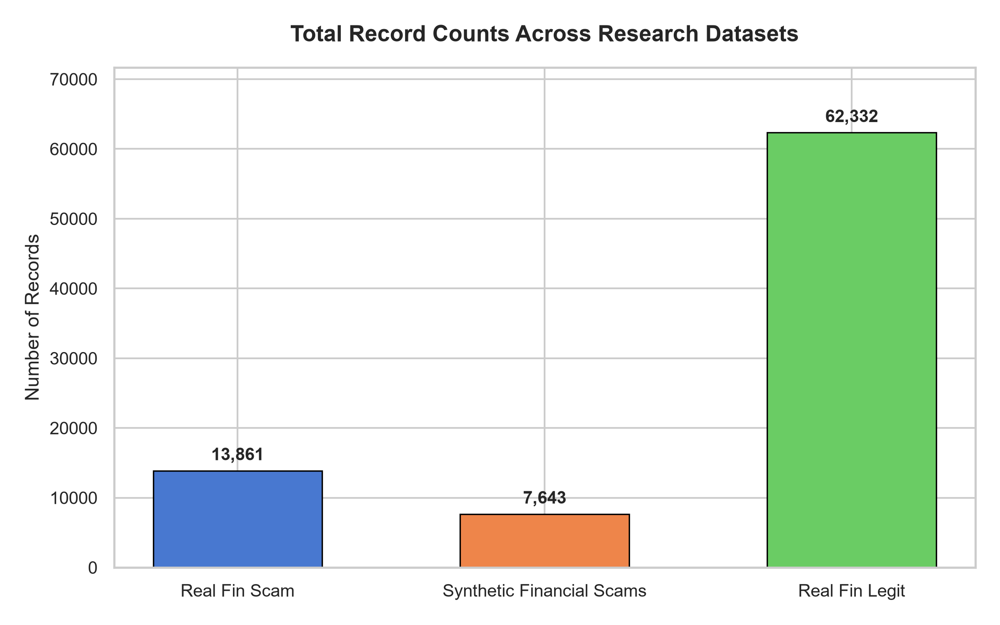
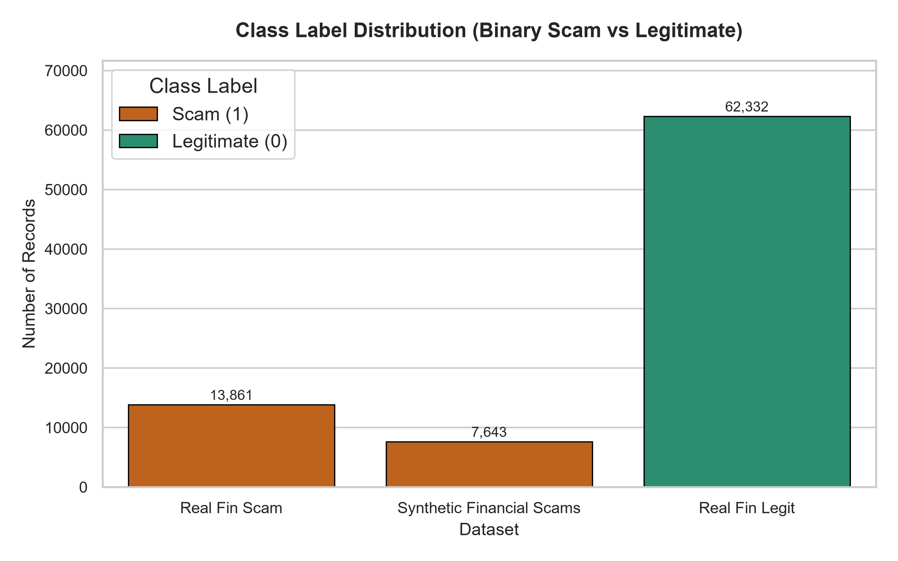
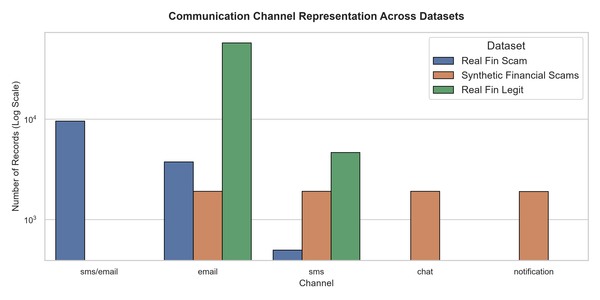
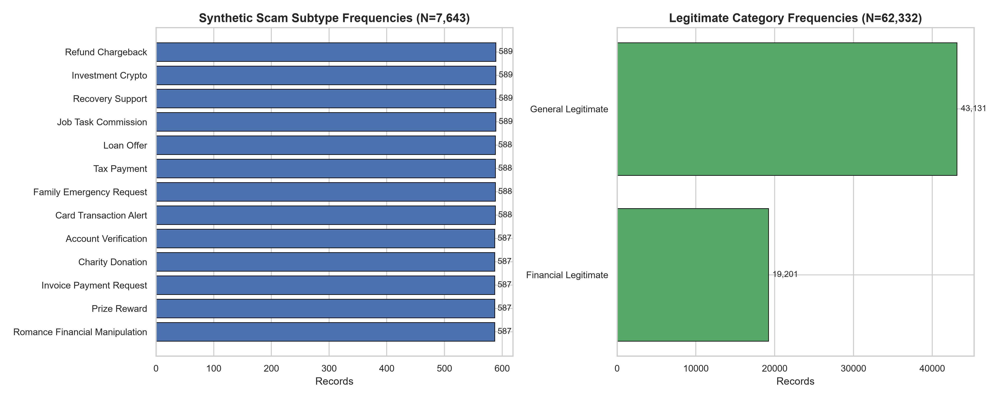
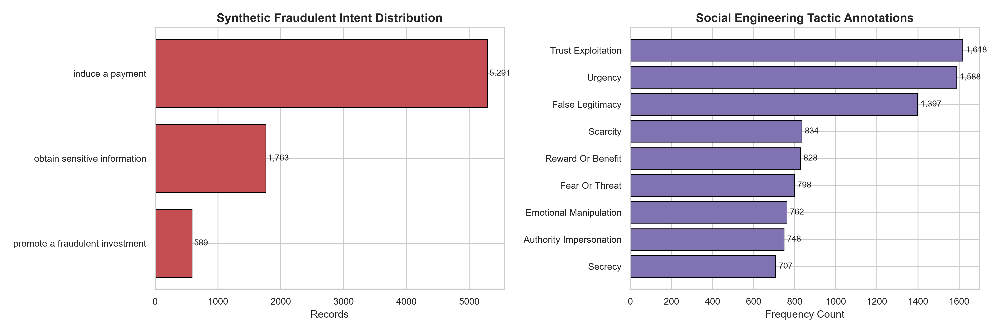
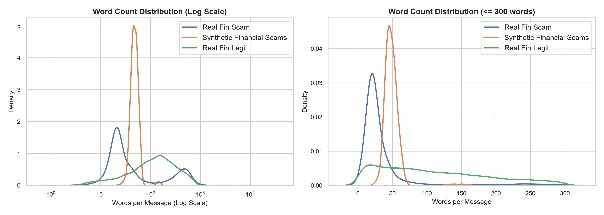
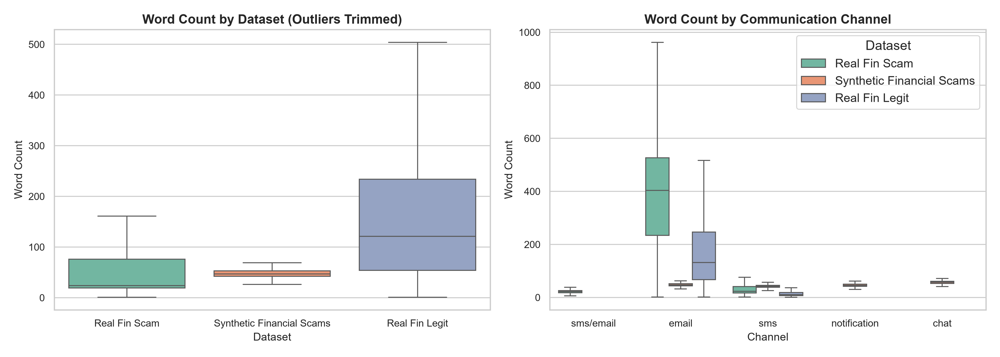
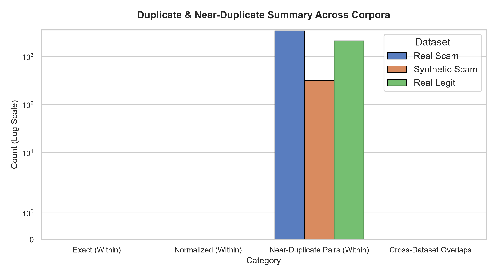
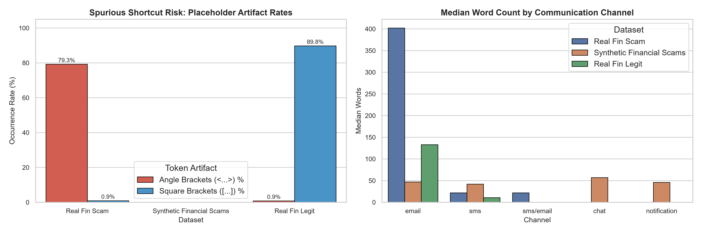

# Comprehensive Research Dataset Audit Report

**Project Title:** An Explainable Multi-Level Transformer-Based Framework for Financial Scam Narrative Detection and Fraud Analysis in Digital Communications

**Audit Date:** 2026-11-06 16:21:02  
**Total Records Analyzed:** `83,836` across `3` distinct corpora (`157.31 MB` total raw footprint)  
**Governance Policy:** Raw CSV assets are preserved without modification in `data/raw/`.

---

## 1. Executive Summary & Corpus Inventory

This technical audit presents a comprehensive, empirical examination of the three foundational corpora assembled for the financial scam research framework. The investigation covers structural schema compatibility, label integrity, textual length dynamics, duplicate and near-duplicate distributions, cross-corpus leakage, and research-critical shortcut learning vulnerabilities.

| Dataset Asset | Filename | Record Count | File Size (MB) | Binary Class Label | Channel Coverage | SHA-256 Provenance Hash |
| :--- | :--- | :--- | :--- | :--- | :--- | :--- |
| **real_fin_scam** | `real_fin_scam.csv` | 13,861 | 12.70 MB | 1:13,861 | sms/email, email, sms | `e00822c1e6469ea7...` |
| **synthetic_financial_scams** | `synthetic_financial_scams.csv` | 7,643 | 4.56 MB | 1:7,643 | sms, email, chat, notification | `8e708fa30aeaed63...` |
| **real_fin_legit** | `real_fin_legit.csv` | 62,332 | 140.05 MB | 0:62,332 | email, sms | `6810244c341b8f48...` |

---

## 2. Structural Inspection & Schema Disparities

A key finding of this structural audit is that the three raw corpora exhibit **heterogeneous schemas**. Downstream modeling requires a unified data ingestion representation rather than assuming identical columns.

### 2.1 Schema: `real_fin_scam`
- **Dimensions:** `13,861` rows × `9` columns
- **Identified Text Column:** `text`
- **Primary Key (`id`):** `Unique (13861 / 13861)`
- **Columns & Dtypes:**
  `id` (object), `text` (object), `label` (int64), `phishing_type` (object), `scam_channel` (object), `source` (object), `source_url` (object), `source_license` (object), `source_record_id` (object)

### 2.2 Schema: `synthetic_financial_scams`
- **Dimensions:** `7,643` rows × `11` columns
- **Identified Text Column:** `text`
- **Primary Key (`id`):** `Unique (7643 / 7643)`
- **Columns & Dtypes:**
  `id` (object), `text` (object), `label` (int64), `phishing_type` (object), `scam_channel` (object), `fraudulent_intent` (object), `social_engineering_tactics` (object), `language` (object), `synthetic` (bool), `generation_scenario` (object), `risk_or_safety_note` (object)

### 2.3 Schema: `real_fin_legit`
- **Dimensions:** `62,332` rows × `13` columns
- **Identified Text Column:** `text`
- **Primary Key (`id`):** `Unique (62332 / 62332)`
- **Columns & Dtypes:**
  `id` (object), `text` (object), `email_subject` (object), `email_body` (object), `label` (int64), `legitimate_category` (object), `communication_type` (object), `scam_channel` (object), `source` (object), `source_url` (object), `source_license` (object), `source_record_id` (object), `synthetic` (bool)

#### Key Schema Variations:
1. **Label Representation:** `real_fin_scam.csv` (`label=1`) and `real_fin_legit.csv` (`label=0`) provide binary supervision. `synthetic_financial_scams.csv` includes `label=1` alongside multi-aspect metadata (`fraudulent_intent` and `social_engineering_tactics`).
2. **Email Sub-fields:** `real_fin_legit.csv` provides isolated `email_subject` and `email_body` for emails, whereas `real_fin_scam.csv` stores consolidated email headers, subjects, and bodies within `text`.
3. **Multi-label Annotations:** Only `synthetic_financial_scams.csv` possesses explicit social engineering tactic labels, formatted as JSON string arrays.

---

## 3. Data Quality & Integrity Audit

Empirical verification of text integrity, null distributions, and anomaly indicators.

| Dataset | Missing / Null Cells | Empty Texts | Whitespace-only Texts | Invalid Labels | Suspiciously Short (<10 chars) | Suspiciously Long (>10k chars) | Quality Verdict |
| :--- | :--- | :--- | :--- | :--- | :--- | :--- | :--- |
| **real_fin_scam** | 3,792 | 0 | 0 | 0 | 1 | 16 | 3,792 missing cells (isolated metadata) |
| **synthetic_financial_scams** | 0 | 0 | 0 | 0 | 0 | 0 | 100% Complete |
| **real_fin_legit** | 10,288 | 0 | 0 | 0 | 29 | 9 | 10,288 missing cells (isolated metadata) |

### Detailed Observations on Data Quality:
1. **Zero Text Absence:** There are **zero** null, empty, or whitespace-only message records across all 83,836 samples.
2. **Missing Metadata Isolation:** In `real_fin_scam.csv`, missing values occur strictly in `source_record_id` (3,792 records). In `real_fin_legit.csv`, missing values occur strictly in `email_subject` (5,618 records) and `email_body` (4,670 records), directly corresponding to SMS communications and subject-less emails.
3. **Extreme Length Outliers:**
   - `real_fin_scam.csv` contains **8** messages exceeding 10,000 characters (max: `121,724` chars / `23,486` words in `FIN-00350`). These represent multi-page 419 financial scam letters and legal contract fabrications.
   - `real_fin_legit.csv` contains **11** messages exceeding 10,000 characters (max: `30,893` chars in `MEAJOR-LEG-054248`).
   - `real_fin_scam.csv` contains short outliers such as `FIN-05033` (`'<URL>'`, 5 chars), representing bare URL smishing messages.
   - `real_fin_legit.csv` contains short SMS messages such as `LEG-FIN-02996` (`':)'`, 2 chars) from the UCI SMS Spam Collection.

---

## 4. Dataset Composition & Analytical Breakdown

### 4.1 Class Label & Channel Distributions
The corpus encompasses binary classification targets, four primary communication channels, and multiple legitimate financial categories.

### 4.2 Synthetic Scam Subtypes, Intent, and Social Engineering Tactics
The synthetic benchmark (`7,643` records) provides balanced coverage across 13 distinct financial scam subtypes (`587-589` records each), 3 fraudulent intents, and 9 social engineering tactics.

| Social Engineering Tactic | Count | Occurrence Rate (%) | Analytical Focus |
| :--- | :--- | :--- | :--- |
| `trust_exploitation` | 1,618 | 21.2% | Behavioral psychological trigger |
| `urgency` | 1,588 | 20.8% | Behavioral psychological trigger |
| `false_legitimacy` | 1,397 | 18.3% | Behavioral psychological trigger |
| `scarcity` | 834 | 10.9% | Behavioral psychological trigger |
| `reward_or_benefit` | 828 | 10.8% | Behavioral psychological trigger |
| `fear_or_threat` | 798 | 10.4% | Behavioral psychological trigger |
| `emotional_manipulation` | 762 | 10.0% | Behavioral psychological trigger |
| `authority_impersonation` | 748 | 9.8% | Behavioral psychological trigger |
| `secrecy` | 707 | 9.3% | Behavioral psychological trigger |

---

## 5. Text Length & Distributional Characterization

Statistical summary of word counts and character lengths across the three research datasets.

| Metric | Real Financial Scam (`real_fin_scam`) | Synthetic Scam (`synthetic_financial_scams`) | Legitimate Communications (`real_fin_legit`) |
| :--- | :--- | :--- | :--- |
| **Record Count** | 13,861 | 7,643 | 62,332 |
| **Word Count: Mean ± Std** | 125.5 ± 285.4 | 49.1 ± 13.5 | 169.1 ± 158.8 |
| **Word Count: Median [IQR]** | 24.0 [19.0 - 74.0] | 47.0 [42.0 - 53.0] | 121.0 [54.0 - 231.0] |
| **Word Count: 90th / 95th Pct** | 468.0 / 559.0 | 59.0 / 63.0 | 398.0 / 517.0 |
| **Word Count: Min / Max** | 1 / 23,486 | 21 / 169 | 1 / 968 |
| **Char Length: Mean ± Std** | 745.3 ± 1591.3 | 320.9 ± 89.1 | 1099.5 ± 1066.2 |
| **Char Length: Median** | 152.0 | 311.0 | 769.0 |

---

## 6. Duplicate & Near-Duplicate Overlap Audit

We evaluated exact raw duplicates, normalized duplicates (lowercased, whitespace collapsed), and near-duplicates via **MinHash LSH** (word 3-gram Jaccard index $\ge 0.85$).

| Scope & Pair | Exact Duplicates | Normalized Duplicates | Near-Duplicate Pairs (LSH $\ge 0.85$) | Finding & Risk Assessment |
| :--- | :--- | :--- | :--- | :--- |
| **Within `real_fin_scam`** | 0 | 0 | 3,452 | **Template campaign clustering** (e.g. 419 letters sharing ~90% body text with variable names/amounts). High data leakage risk under random splitting. |
| **Within `synthetic_financial_scams`** | 0 | 0 | 320 | **Factorial template variants** across writing styles and subtypes. |
| **Within `real_fin_legit`** | 0 | 0 | 2,138 | **Email thread replies & system notices** in MeAJOR. |
| **Cross: Real Scam vs Legit** | 0 | 0 | 0 | **Zero cross-contamination**. Scam and legitimate corpora are completely disjoint. |
| **Cross: Synthetic vs Legit** | 0 | 0 | 0 | **Zero cross-contamination**. |
| **Cross: Real Scam vs Synthetic** | 0 | 0 | 0 | **Zero cross-contamination**. Real and synthetic scam corpora share no overlapping text. |

---

## 7. Research-Specific Biases & Shortcut Learning Risks

Empirical investigation of potential non-causal statistical shortcuts and dataset biases.

### 7.1 Spurious Prediction Shortcut: Token Placeholder Leakage
A severe vulnerability identified during this audit is the presence of **divergent anonymization/redaction placeholders** across datasets:

| Dataset | Total Records | Angle-Bracket Placeholders (`<URL>`, `<PHONE>`) | Angle-Bracket Rate (%) | Square-Bracket Placeholders (`[NAME]`, `[FINANCIAL_INFO]`) | Square-Bracket Rate (%) |
| :--- | :--- | :--- | :--- | :--- | :--- |
| **real_fin_scam** | 13,861 | 10,990 | **79.3%** | 132 | **0.9%** |
| **synthetic_financial_scams** | 7,643 | 0 | **0.0%** | 0 | **0.0%** |
| **real_fin_legit** | 62,332 | 533 | **0.9%** | 55,982 | **89.8%** |

> **CRITICAL RESEARCH ALERT:**  
> **79.3%** of real scam messages contain angle brackets (`<URL>`, `<PHONE>`), whereas less than **1%** of legitimate communications contain them. Conversely, **89.8%** of legitimate communications contain square brackets (`[NAME]`, `[FINANCIAL_INFO]`), while less than **1%** of real scams do.  
> A naive Transformer or TF-IDF model will immediately latch onto these bracket characters as a shallow shortcut, attaining >90% validation accuracy while completely failing to learn semantic financial scam narratives. **These placeholders must be normalized or harmonized in the preprocessing pipeline.**

### 7.2 Channel-Length Confounding (SMS vs Email)
- SMS records have a median word count of **24.0 words** (mean 23.4 words) and rarely exceed 160 characters.
- Email records have a median word count of **127.0 words** (mean 172.7 words), with 95th percentile reaching 498 words.
- Because real scams feature significant SMS representation while legitimate emails dominate `real_fin_legit.csv`, **message length is strongly confounded with class label** unless stratified by channel.

### 7.3 Real vs Synthetic Scam Dynamics
- **Real Scam Word Count Variance:** Mean `125.5`, Std `285.4` (Coefficient of Variation: `2.27`). Extreme skewness.
- **Synthetic Scam Word Count Variance:** Mean `49.1`, Std `13.5` (Coefficient of Variation: `0.27`). Highly regularized, tightly controlled.
- **Type-Token Ratio (TTR):** Real scam TTR = `0.0476` vs Synthetic scam TTR = `0.0088`.

---

## 8. Data Engineering & Architectural Recommendations

Based on the measured empirical findings, the following engineering steps are recommended for Phase 3:

1. **Unified Placeholder Token Normalization:**
   - Harmonize entity placeholders (`<URL>` and `[URL]` -> `[URL]`, `<PHONE>` and `[PHONE]` -> `[PHONE_NUMBER]`, etc.) to neutralize bracket-style shortcut learning.
2. **Grouped / Near-Duplicate Splitting:**
   - Use MinHash near-duplicate clusters during dataset splitting to ensure that template variants (such as 419 email variants) do not leak simultaneously across train and test sets.
3. **Channel-Stratified Evaluation:**
   - Always evaluate models separately across channels (`email`, `sms`, `chat`, `notification`) to prevent channel imbalance from confounding scam narrative detection accuracy.
4. **Controlled Synthetic Hold-Out:**
   - Maintain the synthetic scam corpus as an isolated diagnostic benchmark for intent and social engineering tactic analysis, never blending it unflagged with real-world test sets.