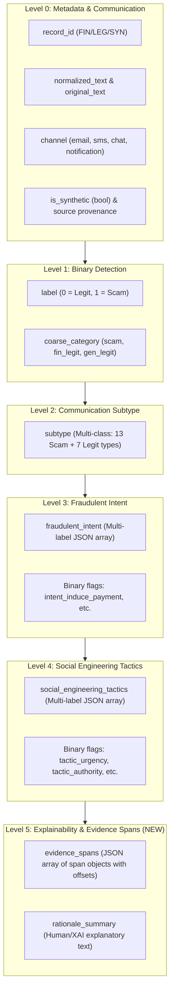

# Multi-Level Annotation Readiness Inspection Report

**Project Title:** An Explainable Multi-Level Transformer-Based Framework for Financial Scam Narrative Detection, Fraud Analysis and Social Engineering Pattern Recognition in Digital Communications  
**Deliverable:** `reports/dataset_audits/multilevel_annotation_readiness.md`  
**Inspection Type:** Read-Only Forensic Audit across Raw and Canonical Processed Assets  
**Evaluation Scope:** Multi-Level Annotation Coverage, Taxonomies, Serialization Formats, and Schema Harmonization  

---

## 1. Executive Summary

This report establishes the empirical ground truth regarding what annotation information is currently available in the repository for training a **Multi-Level Transformer Framework**.

### Key Findings:
1. **Level 1 (Binary Narrative Detection):** Fully supported across all three datasets (83,836 total records: 13,861 real scams, 62,332 real legitimate communications, 7,643 synthetic scams).
2. **Level 2 (Communication Subtype):** Severe taxonomy fragmentation. Real scams have **zero sub-classification** (100% labeled with the monolithic tag `'financial_scam'`). Legitimate records have 7 `communication_type` tags. Synthetic scams have 13 balanced `phishing_type` tags. The naming conventions do not align across datasets.
3. **Level 3 (Fraudulent Intent):** Exists **only** in `synthetic_financial_scams.csv` (3 classes: `induce a payment`, `obtain sensitive information`, `promote a fraudulent investment`). In the real-world datasets (`real_fin_scam.csv` and `real_fin_legit.csv`), intent is **100% unannotated (null)**.
4. **Level 4 (Social Engineering Tactics):** Exists **only** in `synthetic_financial_scams.csv`. It is stored as a JSON-serialized string of lists representing 9 atomic tactics (e.g., `'["scarcity", "urgency"]'`). In real-world data, it is **100% unannotated (null)**.
5. **Level 5 (Evidence Spans & Rationales):** **Zero ground-truth span annotations exist in any dataset.** All existing annotations are strictly coarse, message-level labels. No token offsets, character ranges, or rationales are recorded.
6. **Annotation Level:** 100% of existing annotations are **message-level (document-level)**. None are span-level or token-level.

---

## 2. Dataset Schema Inspection

An audit of column names, data types, missing value percentages, and unique value counts was conducted directly on the raw files (`data/raw/`) and cross-checked against the processed canonical files (`data/processed/`).

### 2.1 Raw Dataset Schemas (`data/raw/`)

#### A. Real Financial Scams (`data/raw/real_fin_scam.csv` — 13,861 records)
| Column Name | Data Type | Null Count | Null % | Unique Values | Annotation Level | Description |
| :--- | :---: | :---: | :---: | :---: | :---: | :--- |
| `id` | `object` (str) | 0 | 0.00% | 13,861 | Identifier | Unique record ID (`FIN-00001`...) |
| `text` | `object` (str) | 0 | 0.00% | 13,861 | Text Payload | Raw communication text |
| `label` | `int64` | 0 | 0.00% | 1 | Message-level | Binary target (`1` for all rows) |
| `phishing_type` | `object` (str) | 0 | 0.00% | 1 | Message-level | Monolithic tag (`financial_scam` for all rows) |
| `scam_channel` | `object` (str) | 0 | 0.00% | 3 | Message-level | Raw channel (`sms/email`: 9,600, `email`: 3,765, `sms`: 496) |
| `source` | `object` (str) | 0 | 0.00% | 4 | Metadata | Upstream dataset provenance |
| `source_url` | `object` (str) | 0 | 0.00% | 4 | Metadata | Provenance URL |
| `source_license` | `object` (str) | 0 | 0.00% | 4 | Metadata | License terms |
| `source_record_id` | `object` (str) | 3,792 | 27.36% | 7,891 | Metadata | Upstream identifier (missing in Kaggle & Smishtank) |

#### B. Real Legitimate Communications (`data/raw/real_fin_legit.csv` — 62,332 records)
| Column Name | Data Type | Null Count | Null % | Unique Values | Annotation Level | Description |
| :--- | :---: | :---: | :---: | :---: | :---: | :--- |
| `id` | `object` (str) | 0 | 0.00% | 62,332 | Identifier | Unique record ID (`LEG-00001`...) |
| `text` | `object` (str) | 0 | 0.00% | 62,332 | Text Payload | Raw communication text |
| `email_subject` | `object` (str) | 5,618 | 9.01% | 37,677 | Sub-message | Email subject line (null for SMS and headless emails) |
| `email_body` | `object` (str) | 4,670 | 7.49% | 57,459 | Sub-message | Email body content (null for SMS) |
| `label` | `int64` | 0 | 0.00% | 1 | Message-level | Binary target (`0` for all rows) |
| `legitimate_category` | `object` (str) | 0 | 0.00% | 2 | Message-level | Broad category (`general_legitimate`, `financial_legitimate`) |
| `communication_type`| `object` (str) | 0 | 0.00% | 7 | Message-level | Fine-grained category (payment, account notice, etc.) |
| `scam_channel` | `object` (str) | 0 | 0.00% | 2 | Message-level | Raw channel (`email`: 57,662, `sms`: 4,670) |
| `source` | `object` (str) | 0 | 0.00% | 5 | Metadata | Upstream dataset provenance |
| `source_url` | `object` (str) | 0 | 0.00% | 3 | Metadata | Provenance URL |
| `source_license` | `object` (str) | 0 | 0.00% | 1 | Metadata | License terms (`CC BY 4.0`) |
| `source_record_id` | `object` (str) | 0 | 0.00% | 62,332 | Metadata | Upstream identifier |
| `synthetic` | `bool` | 0 | 0.00% | 1 | Metadata | Provenance flag (`False` for all rows) |

#### C. Synthetic Financial Scams (`data/raw/synthetic_financial_scams.csv` — 7,643 records)
| Column Name | Data Type | Null Count | Null % | Unique Values | Annotation Level | Description |
| :--- | :---: | :---: | :---: | :---: | :---: | :--- |
| `id` | `object` (str) | 0 | 0.00% | 7,643 | Identifier | Unique record ID (`SYN-00001`...) |
| `text` | `object` (str) | 0 | 0.00% | 7,643 | Text Payload | Synthetic communication text |
| `label` | `int64` | 0 | 0.00% | 1 | Message-level | Binary target (`1` for all rows) |
| `phishing_type` | `object` (str) | 0 | 0.00% | 13 | Message-level | 13 balanced scam subtypes (~588 per subtype) |
| `scam_channel` | `object` (str) | 0 | 0.00% | 4 | Message-level | Balanced channels (`sms`, `email`, `chat`, `notification`) |
| `fraudulent_intent` | `object` (str) | 0 | 0.00% | 3 | Message-level | Intent category (`induce a payment`, etc.) |
| `social_engineering_tactics`| `object` (str) | 0 | 0.00% | 10 | Message-level | JSON stringified list of tactics (`["scarcity", "urgency"]`)|
| `language` | `object` (str) | 0 | 0.00% | 1 | Metadata | Language tag (`en`) |
| `synthetic` | `bool` | 0 | 0.00% | 1 | Metadata | Provenance flag (`True` for all rows) |
| `generation_scenario` | `object` (str) | 0 | 0.00% | 26 | Metadata | Prompt scenario template |
| `risk_or_safety_note`| `object` (str) | 0 | 0.00% | 1 | Metadata | Compliance disclaimer |

---

## 3. Investigation of Key Annotation Dimensions

### Dimension 1: Binary Scam / Legitimate Classification
- **Availability:** 100% available across all datasets.
- **Fields:** `label` (int64: `1` = Scam, `0` = Legitimate).
- **Corpus Distribution:**
  - Real Scams: 13,861 records (`label=1`)
  - Real Legitimate: 62,332 records (`label=0`)
  - Synthetic Scams: 7,643 records (`label=1`)
- **Evaluation Status:** Fully ready for Level 1 binary classification benchmarks.

### Dimension 2: Financial Scam Subtype
- **Availability:** Severely fragmented across datasets.
- **Real Scams (`real_fin_scam.csv`):**
  - Field: `phishing_type`.
  - Values: Only **1 monolithic value** (`financial_scam` for all 13,861 records).
  - *Finding:* No fine-grained scam subtypes exist in the real scam dataset.
- **Real Legitimate (`real_fin_legit.csv`):**
  - Fields: `legitimate_category` (2 values: `general_legitimate` [43,131], `financial_legitimate` [19,201]) and `communication_type` (7 values: `general_communication` [45,781], `payment` [5,848], `account_notice` [3,407], `card_notice` [2,525], `loan_notice` [2,010], `transfer_notice` [1,941], `financial_admin` [820]).
- **Synthetic Scams (`synthetic_financial_scams.csv`):**
  - Field: `phishing_type`.
  - Values: Exactly **13 balanced subtypes** (~587–589 records each):
    1. `refund_chargeback` (589)
    2. `investment_crypto` (589)
    3. `job_task_commission` (589)
    4. `recovery_support` (589)
    5. `card_transaction_alert` (588)
    6. `loan_offer` (588)
    7. `tax_payment` (588)
    8. `family_emergency_request` (588)
    9. `account_verification` (587)
    10. `invoice_payment_request` (587)
    11. `prize_reward` (587)
    12. `romance_financial_manipulation` (587)
    13. `charity_donation` (587)
- *Finding:* The 13-class scam subtype taxonomy is currently populated **only** in the synthetic dataset.

### Dimension 3: Fraudulent Intent
- **Availability:** Populated **exclusively** in `synthetic_financial_scams.csv`.
- **Field:** `fraudulent_intent` (str).
- **Values:**
  1. `induce a payment` (5,291 records, 69.23%)
  2. `obtain sensitive information` (1,763 records, 23.07%)
  3. `promote a fraudulent investment` (589 records, 7.71%)
- **Real Datasets Status:** Completely unpopulated (null in processed splits for all 76,193 real records).
- **Format:** Scalar string (single-label multi-class), though conceptually messages can carry multiple intents.

### Dimension 4: Social-Engineering Tactics
- **Availability:** Populated **exclusively** in `synthetic_financial_scams.csv`.
- **Field:** `social_engineering_tactics` (str).
- **Format:** JSON-serialized string of a list of strings (e.g., `'["scarcity", "urgency"]'`).
- **Atomic Taxonomy (9 Tactics):**
  1. `authority_impersonation`
  2. `emotional_manipulation`
  3. `false_legitimacy`
  4. `fear_or_threat`
  5. `reward_or_benefit`
  6. `scarcity`
  7. `secrecy`
  8. `trust_exploitation`
  9. `urgency`
- **Pattern Distribution in Synthetic Data:**
  - `["trust_exploitation"]`: 911 (11.92%)
  - `["scarcity", "urgency"]`: 834 (10.91%)
  - `["reward_or_benefit"]`: 828 (10.83%)
  - `["fear_or_threat"]`: 798 (10.44%)
  - `["emotional_manipulation"]`: 762 (9.97%)
  - `["urgency"]`: 754 (9.87%)
  - `["authority_impersonation", "false_legitimacy"]`: 748 (9.79%)
  - `["secrecy", "trust_exploitation"]`: 707 (9.25%)
  - `[]` (empty list / no tactic): 652 (8.53%)
  - `["false_legitimacy"]`: 649 (8.49%)
- **Multi-Label Characteristic:** 2,996 records (39.2%) contain multi-tactic combinations (2 tactics each). 652 records contain zero tactics. 3,995 records contain exactly 1 tactic.
- **Real Datasets Status:** Completely unpopulated (null for all 76,193 real records).

### Dimension 5: Communication Channel
- **Real Scam:** `scam_channel` has 3 values (`sms/email` [9,600], `email` [3,765], `sms` [496]). In canonical preprocessing, `sms/email` was mapped to `sms` with carrier gateway tracking (`is_email_gateway=True` for 46 verified header records).
- **Real Legit:** `scam_channel` has 2 values (`email` [57,662], `sms` [4,670]).
- **Synthetic Scams:** `scam_channel` has 4 balanced values (`email` [1,911], `sms` [1,911], `chat` [1,911], `notification` [1,910]). Neither `chat` nor `notification` exists in the real datasets.

### Dimension 6: Synthetic vs. Real Provenance Tracking
- **Raw Scams:** Implicitly real; no explicit boolean column in raw file (`is_synthetic=False` assigned in canonical preprocessing). Sourced from IMC25, Nigerian Fraud, Kaggle, and Smishtank.
- **Raw Legit:** Explicit column `synthetic` (`False` for all rows). Sourced from MeAJOR (trec5/6/7), UCI SMS, and Mendeley Data V2.
- **Raw Synthetic:** Explicit column `synthetic` (`True` for all rows). Contains `generation_scenario` (26 scenario prompts) and compliance note.

### Dimension 7: Evidence Spans & Explanation-Related Annotations
- **Audit Result:** **ZERO evidence span or rationale annotations exist in any dataset.**
- No character offsets (`start_char`, `end_char`), token-level highlight arrays, sentence-level extraction masks, or natural language explanations are present.
- All labels across all datasets are coarse, document-level targets.

---

## 4. Cross-Dataset Comparison Matrix

| Annotation Dimension | Real Scam (`real_fin_scam.csv`) | Real Legit (`real_fin_legit.csv`) | Synthetic Scam (`synthetic_financial_scams.csv`) | Shared Across All 3? |
| :--- | :---: | :---: | :---: | :---: |
| **Level 1: Binary Label** | `1` (13,861) | `0` (62,332) | `1` (7,643) | **YES** |
| **Level 2: Subtype / Category** | Monolithic (`financial_scam`) | 7 `communication_type` tags | 13 `phishing_type` tags | **NO (Taxonomy Mismatch)** |
| **Level 3: Fraudulent Intent** | 100% NULL | 100% NULL | 3 Intent Classes (7,643) | **NO (Synthetic Only)** |
| **Level 4: Social Engineering** | 100% NULL | 100% NULL | 9 Atomic Tactics (7,643) | **NO (Synthetic Only)** |
| **Level 5: Evidence Spans** | **NONE** | **NONE** | **NONE** | **NO (Non-existent)** |
| **Communication Channel** | `sms/email`, `email`, `sms` | `email`, `sms` | `sms`, `email`, `chat`, `notif` | **Partial (Email/SMS shared)** |
| **Provenance Source ID** | 72.6% populated | 100% populated | Not present (internal) | **Partial** |
| **Multi-label Supported?** | No | No | Yes (Tactics only) | **NO** |
| **Serialized Lists Present?** | Yes (62 text rows have `"['..."`) | No | Yes (`social_engineering_tactics`) | **Format Inconsistency** |

---

## 5. Proposed Unified Annotation Schema

To support the full academic research scope without breaking compatibility, a unified multi-level schema is proposed. It integrates the existing fields from all three datasets and defines explicit, typed representations for multi-label dimensions and evidence spans.



### 5.1 Formal Schema Specification

| Field Name | Type | Allowed Values / Schema | Origin Status | Description |
| :--- | :---: | :--- | :--- | :--- |
| `record_id` | `str` | e.g. `FIN-00001`, `LEG-00001`, `SYN-00001` | **Existing** | Unique record identifier |
| `original_text` | `str` | Raw string | **Existing** | Unmodified input text |
| `normalized_text` | `str` | Normalized string (bracketed entities) | **Existing** | Preprocessed input text |
| `is_synthetic` | `bool` | `True`, `False` | **Existing** | Synthetic provenance flag |
| `channel` | `str` | `email`, `sms`, `chat`, `notification` | **Existing** | Harmonized communication transport |
| `source` | `str` | Dataset name | **Existing** | Upstream provenance name |
| `label` | `int` | `0` (Legitimate), `1` (Financial Scam) | **Existing** | **Level 1 Target** |
| `coarse_category` | `str` | `financial_scam`, `financial_legitimate`, `general_legitimate` | **Existing** | Derived coarse partition |
| `subtype` | `str` | **20 Classes:** 13 Scam subtypes + 7 Legit types | **Harmonized** | **Level 2 Target (Multi-class)** |
| `fraudulent_intent` | `str` (JSON) | Array of strings from: `["induce_payment", "obtain_sensitive_information", "promote_fraudulent_investment"]` (or `[]` for legit) | **Standardized** | **Level 3 Target (Multi-label)** |
| `social_engineering_tactics` | `str` (JSON) | Array of strings from 9 atomic tactics: `["authority_impersonation", "emotional_manipulation", "false_legitimacy", "fear_or_threat", "reward_or_benefit", "scarcity", "secrecy", "trust_exploitation", "urgency"]` (or `[]`) | **Existing in Syn** | **Level 4 Target (Multi-label)** |
| `evidence_spans` | `str` (JSON) | Array of span dicts: `[{"span_text": str, "start_char": int, "end_char": int, "level": str, "label": str}]` | **[PROPOSED NEW]** | **Level 5 Target (Span-level)** |
| `rationale_summary` | `str` | Natural language explanation or attribution rationale | **[PROPOSED NEW]** | **Level 5 Target (XAI)** |

---

### 5.2 Concrete Example Records Under Unified Schema

#### Example 1: Real-World Financial Scam (`data/raw/real_fin_scam.csv` — `FIN-00001`)
```json
{
  "record_id": "FIN-00001",
  "original_text": "URGENT BUSINESS ASSISTANCE AND PARTNERSHIP FROM:MR. JAMES NGOLA. CONFIDENTIAL TEL: [PHONE_NUMBER]...",
  "normalized_text": "URGENT BUSINESS ASSISTANCE AND PARTNERSHIP FROM:MR. JAMES NGOLA. CONFIDENTIAL TEL: [PHONE_NUMBER]...",
  "is_synthetic": false,
  "channel": "email",
  "source": "Nigerian_Fraud.csv",
  "label": 1,
  "coarse_category": "financial_scam",
  "subtype": "financial_scam", 
  "fraudulent_intent": null,
  "social_engineering_tactics": null,
  "evidence_spans": null,
  "rationale_summary": null
}
```
*(Note: Real-world scam records currently have null for Levels 3, 4, and 5 because no annotations exist in the raw source).*

#### Example 2: Real-World Legitimate Communication (`data/raw/real_fin_legit.csv` — `LEG-00001`)
```json
{
  "record_id": "LEG-00001",
  "original_text": "Attached is the monthly invoice for our gas supply agreement under GTC Spot contracts...",
  "normalized_text": "Attached is the monthly invoice for our gas supply agreement under GTC Spot contracts...",
  "is_synthetic": false,
  "channel": "email",
  "source": "MeAJOR (trec5)",
  "label": 0,
  "coarse_category": "financial_legitimate",
  "subtype": "payment",
  "fraudulent_intent": [],
  "social_engineering_tactics": [],
  "evidence_spans": [],
  "rationale_summary": "Legitimate business correspondence discussing routine contractual invoicing with no indicators of deception."
}
```

#### Example 3: Synthetic Financial Scam (`data/raw/synthetic_financial_scams.csv` — `SYN-00102`)
```json
{
  "record_id": "SYN-00102",
  "original_text": "SECURITY ALERT: Unauthorized login detected from new device. Your debit card ending in 4102 has been locked. Verify immediately at http://secure-bank-login.xyz to unlock.",
  "normalized_text": "SECURITY ALERT: Unauthorized login detected from new device. Your debit card ending in 4102 has been locked. Verify immediately at [URL] to unlock.",
  "is_synthetic": true,
  "channel": "sms",
  "source": "synthetic_generation_scenario_04",
  "label": 1,
  "coarse_category": "financial_scam",
  "subtype": "card_transaction_alert",
  "fraudulent_intent": ["obtain_sensitive_information"],
  "social_engineering_tactics": ["fear_or_threat", "urgency", "false_legitimacy"],
  "evidence_spans": [
    {
      "span_text": "Your debit card ending in 4102 has been locked.",
      "start_char": 61,
      "end_char": 108,
      "level": "social_engineering_tactics",
      "label": "fear_or_threat"
    },
    {
      "span_text": "Verify immediately at [URL] to unlock.",
      "start_char": 109,
      "end_char": 147,
      "level": "fraudulent_intent",
      "label": "obtain_sensitive_information"
    }
  ],
  "rationale_summary": "The message uses false security alerts to induce fear of account suspension, demanding immediate credential submission via an unverified link."
}
```

---

## 6. Recommended Next Implementation Steps

To transition the project towards multi-level modeling while respecting the 10-day Phase 1 timeline:

### Step 1: Formalize Dual-Track Experimental Design (Phase 1 Baseline)
- **Track A (Empirical In-Distribution Benchmark):** Train and evaluate Level 1 (Binary Scam Detection) on the **76,193 real-world partition** (`train.csv`, `val.csv`, `test.csv`).
- **Track B (Multi-Level Framework Testbed):** Train and evaluate the multi-level architecture (Level 1 Binary + Level 2 Subtype + Level 3 Intent + Level 4 Tactics) on the **7,643 synthetic records** (`synthetic_financial_scams_processed.csv`), where ground-truth labels for all levels already exist.
- *Scientific Defense:* Demonstrates the full multi-level architecture working end-to-end on a controlled synthetic corpus, while benchmarking binary narrative detection on real-world data.

### Step 2: Preprocessing Hygiene & Deserialization
- In `src/preprocessing/` and future data loaders, parse JSON-serialized strings in `social_engineering_tactics` (e.g. `'["scarcity", "urgency"]'`) into clean binary multi-hot vectors (`MultiLabelBinarizer` with the 9 atomic classes) to avoid string-parsing overhead during model batching.
- Sanitize the 62 raw scam text records starting with stringified lists (`"['Amazon:..."`) so Transformer tokenizers do not ingest Python punctuation artifacts.

### Step 3: Phase 2 Real-World Annotation Pilot (Post-Phase 1)
- Once Phase 1 is defended, sample **1,500 real-world scam messages** (stratified across Nigerian 419, IMC25, and Smishtank) and annotate them using the synthetic 13-subtype, 3-intent, and 9-tactic taxonomy.
- This creates the first real-world multi-level benchmark for financial scam narratives.

### Step 4: Explainability & Evidence Spans (Post-Hoc Attribution in Phase 1)
- Because no ground-truth span annotations currently exist in the datasets, **evidence spans in Phase 1 must be generated via post-hoc XAI attribution methods** (e.g., Integrated Gradients, SHAP, and Transformer attention weights) rather than supervised span classification.
- Include attention visualization in the Phase 1 deliverable to show token-level highlights supporting each predicted tactic.
