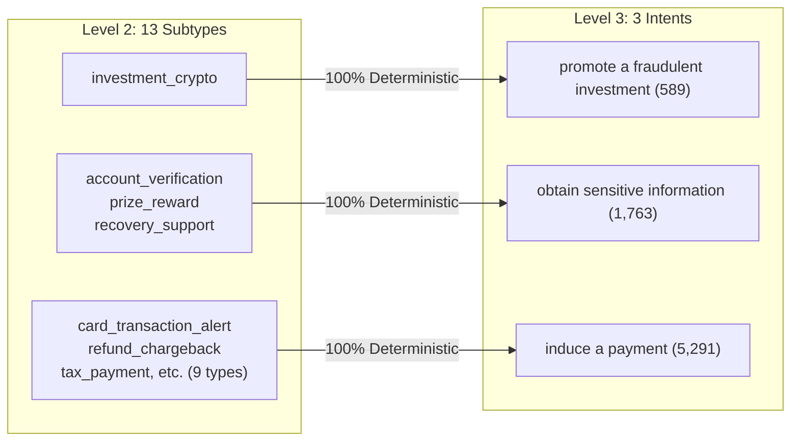
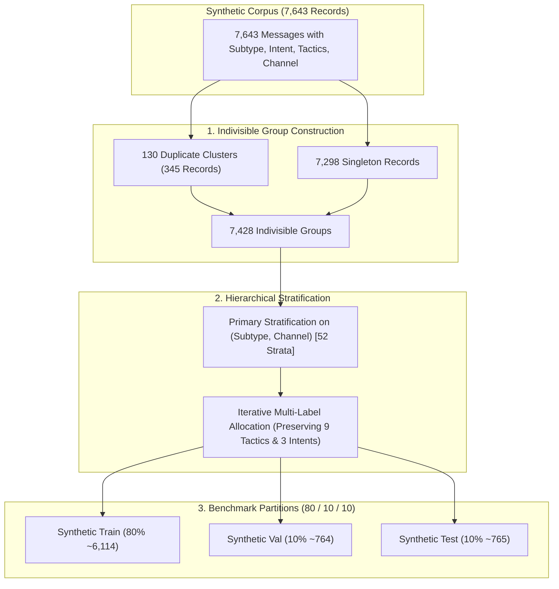

# Synthetic Multi-Level Dataset Validation Report

**Project Title:** An Explainable Multi-Level Transformer-Based Framework for Financial Scam Narrative Detection, Fraud Analysis and Social Engineering Pattern Recognition in Digital Communications  
**Deliverable Path:** `reports/dataset_audits/synthetic_multilevel_validation.md`  
**Dataset Under Inspection:** `data/raw/synthetic_financial_scams.csv` & `data/processed/synthetic_financial_scams_processed.csv`  
**Scope:** Multi-Level Class Distributions, Factorial Template Mechanics, Label Consistency, Duplicate Clusters, and Splitting Recommendations  
**Mode:** Read-Only Audit — Zero Datasets, Splits, or Modules Modified  

---

## 1. Executive Summary

This report delivers a comprehensive forensic audit of the **7,643 synthetic financial scam records** in the repository. The synthetic dataset represents the **only corpus in the project containing multi-level annotations** across Subtype, Intent, and Social Engineering Tactics.

### Key Audit Discoveries:
1. **Subtype Balance:** Exactly 13 `phishing_type` classes, uniformly distributed across ~587 to 589 records each (7.68% – 7.71%).
2. **Channel Balance:** Exactly 4 communication channels (`sms`, `email`, `chat`, `notification`), perfectly balanced (~1,911 records per channel).
3. **Intent Determinism:** **`fraudulent_intent` is a strict, 100% deterministic mathematical aggregation of `phishing_type` ($H(\text{intent} \mid \text{subtype}) = 0$).** Intra-subtype intent variance is zero.
4. **Semantic Labeling Discrepancies:** In `card_transaction_alert` (100% labeled as `induce a payment`), messages frequently ask users to *"Reply with missing information"* or *"Send confirmation code"*—actions characteristic of `obtain sensitive information`.
5. **Template & Prompt Artifacts:**
   - **100.00% of messages (7,643 records)** contain the word `"fictional"`.
   - **25.00% of messages (1,911 records)** begin with the prefix `"NOTICE <N>:"` (all SMS messages).
   - **24 messages** contain unedited prompt engineering / meta-commentary instructions embedded directly into the text field.
6. **Near-Duplicate Cross-Subtype Leakage:** **345 records** reside in **130 near-duplicate clusters**. Crucially, identical sentence templates cross *different* subtype classes (e.g. Cluster `C0008` uses an identical sentence across `account_verification`, `tax_payment`, `recovery_support`, and `charity_donation`). A random split would introduce severe label contradiction leakage.
7. **Multi-Label Aware Splitting Requirement:** Partitioning this dataset requires **Cluster-Aware Multi-Label Stratified Group Partitioning** to keep duplicate clusters indivisible while preserving the 13 subtypes, 4 channels, and 9 multi-label tactics.

---

## 2. Distribution of the 13 Phishing Subtypes

The synthetic dataset exhibits a near-perfect balanced distribution across 13 financial scam subtypes:

| # | Phishing Subtype (`phishing_type`) | Record Count | % of Corpus | SMS Count | Email Count | Chat Count | Notification Count |
| :-: | :--- | :---: | :---: | :---: | :---: | :---: | :---: |
| 1 | `refund_chargeback` | 589 | 7.71% | 148 | 147 | 147 | 147 |
| 2 | `investment_crypto` | 589 | 7.71% | 148 | 147 | 147 | 147 |
| 3 | `job_task_commission` | 589 | 7.71% | 147 | 148 | 147 | 147 |
| 4 | `recovery_support` | 589 | 7.71% | 147 | 147 | 148 | 147 |
| 5 | `card_transaction_alert` | 588 | 7.69% | 147 | 147 | 147 | 147 |
| 6 | `loan_offer` | 588 | 7.69% | 147 | 147 | 147 | 147 |
| 7 | `tax_payment` | 588 | 7.69% | 147 | 147 | 147 | 147 |
| 8 | `family_emergency_request` | 588 | 7.69% | 147 | 147 | 147 | 147 |
| 9 | `account_verification` | 587 | 7.68% | 147 | 147 | 147 | 146 |
| 10 | `invoice_payment_request` | 587 | 7.68% | 147 | 147 | 147 | 146 |
| 11 | `prize_reward` | 587 | 7.68% | 147 | 147 | 146 | 147 |
| 12 | `romance_financial_manipulation` | 587 | 7.68% | 146 | 147 | 147 | 147 |
| 13 | `charity_donation` | 587 | 7.68% | 147 | 146 | 147 | 147 |
| **Total** | **All 13 Subtypes** | **7,643** | **100.00%** | **1,911** | **1,911** | **1,911** | **1,910** |

---

## 3. Distribution of the 3 Fraudulent Intent Categories

| # | Fraudulent Intent (`fraudulent_intent`) | Record Count | % of Corpus | Subtypes Mapped to Intent |
| :-: | :--- | :---: | :---: | :--- |
| 1 | `induce a payment` | 5,291 | 69.23% | 9 Subtypes (`card_transaction_alert`, `charity_donation`, `family_emergency_request`, `invoice_payment_request`, `job_task_commission`, `loan_offer`, `refund_chargeback`, `romance_financial_manipulation`, `tax_payment`) |
| 2 | `obtain sensitive information` | 1,763 | 23.07% | 3 Subtypes (`account_verification`, `prize_reward`, `recovery_support`) |
| 3 | `promote a fraudulent investment` | 589 | 7.71% | 1 Subtype (`investment_crypto`) |
| **Total** | **All 3 Intents** | **7,643** | **100.00%** | **13 Subtypes** |

---

## 4. Distribution of Social-Engineering Tactics

### 4.1 Atomic Tactic Occurrences Across Messages
A message can contain 0, 1, or 2 atomic tactics. The prevalence of each individual tactic across the 7,643 messages is:

| # | Atomic Tactic | Message Count | Prevalence % | Frequency Rank | Typical Linguistic Markers in Synthetic Text |
| :-: | :--- | :---: | :---: | :---: | :--- |
| 1 | `trust_exploitation` | 1,618 | 21.17% | 1 | "Send confirmation code shown in your fictional app", "routine review" |
| 2 | `urgency` | 1,588 | 20.78% | 2 | "The stated window is limited", "before next review", "act immediately" |
| 3 | `false_legitimacy` | 1,397 | 18.28% | 3 | "Reference: [CASE REDACTED]", "Fictional desk: fictional billing desk" |
| 4 | `scarcity` | 834 | 10.91% | 4 | "Window is limited and request may be reassigned afterward" |
| 5 | `reward_or_benefit` | 828 | 10.83% | 5 | "Pay handling charge before next review", prize claim references |
| 6 | `fear_or_threat` | 798 | 10.44% | 6 | "Account will be marked pending", "card has been locked" |
| 7 | `emotional_manipulation` | 762 | 9.97% | 7 | "Family emergency", private personal matter framing |
| 8 | `authority_impersonation` | 748 | 9.79% | 8 | "This notice was generated by [FICTIONAL ORGANIZATION]", claims desk |
| 9 | `secrecy` | 707 | 9.25% | 9 | "This message is marked confidential", "avoid unrelated channels" |

### 4.2 Tactic Combinations & Empty List Frequency
In `synthetic_financial_scams.csv`, tactics are represented exclusively by **10 distinct serialized combination patterns**:

| Combination Pattern (`social_engineering_tactics`) | Tactic Cardinality | Message Count | Percentage |
| :--- | :---: | :---: | :---: |
| `["trust_exploitation"]` | 1 | 911 | 11.92% |
| `["scarcity", "urgency"]` | 2 | 834 | 10.91% |
| `["reward_or_benefit"]` | 1 | 828 | 10.83% |
| `["fear_or_threat"]` | 1 | 798 | 10.44% |
| `["emotional_manipulation"]` | 1 | 762 | 9.97% |
| `["urgency"]` | 1 | 754 | 9.87% |
| `["authority_impersonation", "false_legitimacy"]` | 2 | 748 | 9.79% |
| `["secrecy", "trust_exploitation"]` | 2 | 707 | 9.25% |
| `[]` **(Empty list — No tactic assigned)** | **0** | **652** | **8.53%** |
| `["false_legitimacy"]` | 1 | 649 | 8.49% |
| **Total** | — | **7,643** | **100.00%** |

#### Cardinality Distribution:
- **0 Tactics (`[]`):** 652 records (**8.53%**)
- **1 Tactic:** 4,702 records (**61.52%**)
- **2 Tactics:** 2,289 records (**29.95%**)
- **3+ Tactics:** 0 records (**0.00%**)

---

## 5. Relationships Between Subtype, Intent, Tactics & Scenarios

### 5.1 Subtype-to-Intent Determinism ($H = 0$)
Cross-tabulating `phishing_type` against `fraudulent_intent` proves that `fraudulent_intent` is not an independently assigned label:

| Phishing Subtype | Induce a Payment | Obtain Sensitive Information | Promote a Fraudulent Investment | Total Records | Dominant Intent % |
| :--- | :---: | :---: | :---: | :---: | :---: |
| `account_verification` | 0 | **587** | 0 | 587 | **100.0%** |
| `card_transaction_alert` | **588** | 0 | 0 | 588 | **100.0%** |
| `charity_donation` | **587** | 0 | 0 | 587 | **100.0%** |
| `family_emergency_request` | **588** | 0 | 0 | 588 | **100.0%** |
| `investment_crypto` | 0 | 0 | **589** | 589 | **100.0%** |
| `invoice_payment_request` | **587** | 0 | 0 | 587 | **100.0%** |
| `job_task_commission` | **589** | 0 | 0 | 589 | **100.0%** |
| `loan_offer` | **588** | 0 | 0 | 588 | **100.0%** |
| `prize_reward` | 0 | **587** | 0 | 587 | **100.0%** |
| `recovery_support` | 0 | **589** | 0 | 589 | **100.0%** |
| `refund_chargeback` | **589** | 0 | 0 | 589 | **100.0%** |
| `romance_financial_manipulation` | **587** | 0 | 0 | 587 | **100.0%** |
| `tax_payment` | **588** | 0 | 0 | 588 | **100.0%** |

### 5.2 Factorial Combinatorial Generation Design
Cross-tabulating `phishing_type` vs `social_engineering_tactics` reveals that every single subtype is crossed with **all 10 tactic combinations** in roughly uniform proportions (~48 to 78 records per cell).

Furthermore, auditing `generation_scenario` revealed exactly **26 generator prompt scenarios**:
- **13 Standard Scenarios:** Exactly 576 records each ($13 \times 576 = 7,488$ records).
- **13 Edge-Case Scenarios:** Exactly 11 to 13 records each (totaling 155 records).
- Each `phishing_type` maps to exactly one standard scenario and one edge-case scenario.

---

## 6. Data Quality, Semantic Consistency & Sourcing Artifacts

1. **JSON Parsing Integrity:** All 7,643 values in `social_engineering_tactics` parse cleanly into Python lists using `json.loads()` with **0 parsing errors**.
2. **Missing Values:** Exactly **0 missing/null values** in `synthetic_financial_scams.csv`.
3. **Semantic Inconsistency (Subtype vs. Intent):**
   - In `card_transaction_alert`, 100% of messages are labeled with intent `induce a payment`.
   - However, inspection of message texts (e.g. `SYN-FIN-00578`, `SYN-FIN-00580`) reveals explicit requests: *"Reply with the missing information so the review can close"* or *"Send the confirmation code shown in your fictional app."*
   - These messages functionally execute **credential/token theft (`obtain sensitive information`)**, yet the dataset labels them as payment induction due to rigid subtype-level grouping.
4. **Universal "Fictional" Lexical Leakage:**
   - **100.00% of records (7,643 out of 7,643)** contain the word `"fictional"` in the message body.
   - *Risk:* If a model is trained on this data to classify scam vs legitimate, it can trivially memorize `"fictional"` as an artificial trigger.
5. **Prompt Injection / Meta-Commentary Contamination:**
   - Exactly **24 records** (e.g. `SYN-FIN-05187`) contain unedited LLM prompt engineering instructions directly appended to the text payload:
     > *"A follow-up paragraph claims that several ordinary-looking records were matched together and that the recipient was selected for an additional review. It asks the reader to remain in the same conversation and avoid using unrelated support channels. These details are fictional and included to test whether a model notices indirect pressure..."*
   - These 24 records must be scrubbed or isolated prior to transformer fine-tuning.

---

## 7. Representative Examples per Subtype (5 per Subtype)

Below are 5 representative examples for each of the 13 subtypes, detailing ID, channel, intent, tactics, and text payload:

### 1. `account_verification`
- **[SYN-FIN-00001]** | Channel: `sms` | Intent: `obtain sensitive information` | Tactics: `["false_legitimacy"]`  
  *Text:* `"NOTICE 1: A quiet review has been placed on the account. Confirm the requested details through [LINK REDACTED]. Reference: [CASE REDACTED]. Fictional desk: fictional account desk."`
- **[SYN-FIN-00002]** | Channel: `sms` | Intent: `obtain sensitive information` | Tactics: `["authority_impersonation", "false_legitimacy"]`  
  *Text:* `"NOTICE 2: A quiet review has been placed on the account. Reply with the missing information so the review can close. The fictional service desk will mark the record pending until it hears back. Fictional desk: fictional account desk."`
- **[SYN-FIN-00003]** | Channel: `sms` | Intent: `obtain sensitive information` | Tactics: `["reward_or_benefit"]`  
  *Text:* `"NOTICE 3: A quiet review has been placed on the account. Pay the [AMOUNT REDACTED] handling charge before the next review. This notice was generated by [FICTIONAL ORGANIZATION]. Fictional desk: fictional account desk."`
- **[SYN-FIN-00004]** | Channel: `sms` | Intent: `obtain sensitive information` | Tactics: `["trust_exploitation"]`  
  *Text:* `"NOTICE 4: A quiet review has been placed on the account. Send the confirmation code shown in your fictional app. The stated window is limited and the request may be reassigned afterward. Fictional desk: fictional account desk."`
- **[SYN-FIN-00005]** | Channel: `sms` | Intent: `obtain sensitive information` | Tactics: `["authority_impersonation", "false_legitimacy"]`  
  *Text:* `"NOTICE 5: The fictional account desk says one part of your account needs attention. Confirm the requested details through [LINK REDACTED]. The fictional service desk will mark the record pending until it hears back. Fictional desk: fictional account desk."`

### 2. `card_transaction_alert`
- **[SYN-FIN-00577]** | Channel: `sms` | Intent: `induce a payment` | Tactics: `["urgency"]`  
  *Text:* `"NOTICE 577: A quiet review has been placed on the card. Confirm the requested details through [LINK REDACTED]. The fictional service desk will mark the record pending until it hears back. Fictional desk: fictional card desk."`
- **[SYN-FIN-00578]** | Channel: `sms` | Intent: `induce a payment` | Tactics: `["fear_or_threat"]`  
  *Text:* `"NOTICE 578: A quiet review has been placed on the card. Reply with the missing information so the review can close. This notice was generated by [FICTIONAL ORGANIZATION]. Fictional desk: fictional card desk."`
- **[SYN-FIN-00579]** | Channel: `sms` | Intent: `induce a payment` | Tactics: `["scarcity", "urgency"]`  
  *Text:* `"NOTICE 579: A quiet review has been placed on the card. Pay the [AMOUNT REDACTED] handling charge before the next review. The stated window is limited and the request may be reassigned afterward. Fictional desk: fictional card desk."`
- **[SYN-FIN-00580]** | Channel: `sms` | Intent: `induce a payment` | Tactics: `["emotional_manipulation"]`  
  *Text:* `"NOTICE 580: A quiet review has been placed on the card. Send the confirmation code shown in your fictional app. No physical letter is described in this fictional example. Fictional desk: fictional card desk."`
- **[SYN-FIN-00581]** | Channel: `sms` | Intent: `induce a payment` | Tactics: `["fear_or_threat"]`  
  *Text:* `"NOTICE 581: The fictional card desk says one part of your card needs attention. Confirm the requested details through [LINK REDACTED]. This notice was generated by [FICTIONAL ORGANIZATION]. Fictional desk: fictional card desk."`

### 3. `charity_donation`
- **[SYN-FIN-06913]** | Channel: `sms` | Intent: `induce a payment` | Tactics: `["false_legitimacy"]`  
  *Text:* `"NOTICE 6913: A quiet review has been placed on the relief campaign. Confirm the requested details through [LINK REDACTED]. Reference: [CASE REDACTED]. Fictional desk: fictional campaign desk."`
- **[SYN-FIN-06914]** | Channel: `sms` | Intent: `induce a payment` | Tactics: `["authority_impersonation", "false_legitimacy"]`  
  *Text:* `"NOTICE 6914: A quiet review has been placed on the relief campaign. Reply with the missing information so the review can close. The fictional service desk will mark the record pending until it hears back. Fictional desk: fictional campaign desk."`
- **[SYN-FIN-06915]** | Channel: `sms` | Intent: `induce a payment` | Tactics: `["reward_or_benefit"]`  
  *Text:* `"NOTICE 6915: A quiet review has been placed on the relief campaign. Pay the [AMOUNT REDACTED] handling charge before the next review. This notice was generated by [FICTIONAL ORGANIZATION]. Fictional desk: fictional campaign desk."`
- **[SYN-FIN-06916]** | Channel: `sms` | Intent: `induce a payment` | Tactics: `["trust_exploitation"]`  
  *Text:* `"NOTICE 6916: A quiet review has been placed on the relief campaign. Send the confirmation code shown in your fictional app. The stated window is limited and the request may be reassigned afterward. Fictional desk: fictional campaign desk."`
- **[SYN-FIN-06917]** | Channel: `sms` | Intent: `induce a payment` | Tactics: `["authority_impersonation", "false_legitimacy"]`  
  *Text:* `"NOTICE 6917: The fictional campaign desk says one part of your relief campaign needs attention. Confirm the requested details through [LINK REDACTED]. The fictional service desk will mark the record pending until it hears back. Fictional desk: fictional campaign desk."`

### 4. `family_emergency_request`
- **[SYN-FIN-05761]** | Channel: `sms` | Intent: `induce a payment` | Tactics: `["reward_or_benefit"]`  
  *Text:* `"NOTICE 5761: A quiet review has been placed on the family message. Confirm the requested details through [LINK REDACTED]. Reference: [CASE REDACTED]. Fictional desk: fictional relative."`
- **[SYN-FIN-05762]** | Channel: `sms` | Intent: `induce a payment` | Tactics: `["trust_exploitation"]`  
  *Text:* `"NOTICE 5762: A quiet review has been placed on the family message. Reply with the missing information so the review can close. The fictional service desk will mark the record pending until it hears back. Fictional desk: fictional relative."`
- **[SYN-FIN-05763]** | Channel: `sms` | Intent: `induce a payment` | Tactics: `["authority_impersonation", "false_legitimacy"]`  
  *Text:* `"NOTICE 5763: A quiet review has been placed on the family message. Pay the [AMOUNT REDACTED] handling charge before the next review. This notice was generated by [FICTIONAL ORGANIZATION]. Fictional desk: fictional relative."`
- **[SYN-FIN-05764]** | Channel: `sms` | Intent: `induce a payment` | Tactics: `["false_legitimacy"]`  
  *Text:* `"NOTICE 5764: A quiet review has been placed on the family message. Send the confirmation code shown in your fictional app. The stated window is limited and the request may be reassigned afterward. Fictional desk: fictional relative."`
- **[SYN-FIN-05765]** | Channel: `sms` | Intent: `induce a payment` | Tactics: `["trust_exploitation"]`  
  *Text:* `"NOTICE 5765: The fictional relative says one part of your family message needs attention. Confirm the requested details through [LINK REDACTED]. The fictional service desk will mark the record pending until it hears back. Fictional desk: fictional relative."`

### 5. `investment_crypto`
- **[SYN-FIN-02881]** | Channel: `sms` | Intent: `promote a fraudulent investment` | Tactics: `["authority_impersonation", "false_legitimacy"]`  
  *Text:* `"NOTICE 2881: A quiet review has been placed on the investment plan. Confirm the requested details through [LINK REDACTED]. Reference: [CASE REDACTED]. Fictional desk: fictional investment desk."`
- **[SYN-FIN-02882]** | Channel: `sms` | Intent: `promote a fraudulent investment` | Tactics: `["reward_or_benefit"]`  
  *Text:* `"NOTICE 2882: A quiet review has been placed on the investment plan. Reply with the missing information so the review can close. The fictional service desk will mark the record pending until it hears back. Fictional desk: fictional investment desk."`
- **[SYN-FIN-02883]** | Channel: `sms` | Intent: `promote a fraudulent investment` | Tactics: `["trust_exploitation"]`  
  *Text:* `"NOTICE 2883: A quiet review has been placed on the investment plan. Pay the [AMOUNT REDACTED] handling charge before the next review. This notice was generated by [FICTIONAL ORGANIZATION]. Fictional desk: fictional investment desk."`
- **[SYN-FIN-02884]** | Channel: `sms` | Intent: `promote a fraudulent investment` | Tactics: `["authority_impersonation", "false_legitimacy"]`  
  *Text:* `"NOTICE 2884: A quiet review has been placed on the investment plan. Send the confirmation code shown in your fictional app. The stated window is limited and the request may be reassigned afterward. Fictional desk: fictional investment desk."`
- **[SYN-FIN-02885]** | Channel: `sms` | Intent: `promote a fraudulent investment` | Tactics: `["false_legitimacy"]`  
  *Text:* `"NOTICE 2885: The fictional investment desk says one part of your investment plan needs attention. Confirm the requested details through [LINK REDACTED]. The fictional service desk will mark the record pending until it hears back. Fictional desk: fictional investment desk."`

### 6. `invoice_payment_request`
- **[SYN-FIN-01729]** | Channel: `sms` | Intent: `induce a payment` | Tactics: `["emotional_manipulation"]`  
  *Text:* `"NOTICE 1729: A quiet review has been placed on the invoice. Confirm the requested details through [LINK REDACTED]. Reference: [CASE REDACTED]. Fictional desk: fictional accounts desk."`
- **[SYN-FIN-01730]** | Channel: `sms` | Intent: `induce a payment` | Tactics: `["authority_impersonation", "false_legitimacy"]`  
  *Text:* `"NOTICE 1730: A quiet review has been placed on the invoice. Reply with the missing information so the review can close. The fictional service desk will mark the record pending until it hears back. Fictional desk: fictional accounts desk."`
- **[SYN-FIN-01731]** | Channel: `sms` | Intent: `induce a payment` | Tactics: `["reward_or_benefit"]`  
  *Text:* `"NOTICE 1731: A quiet review has been placed on the invoice. Pay the [AMOUNT REDACTED] handling charge before the next review. This notice was generated by [FICTIONAL ORGANIZATION]. Fictional desk: fictional accounts desk."`
- **[SYN-FIN-01732]** | Channel: `sms` | Intent: `induce a payment` | Tactics: `["trust_exploitation"]`  
  *Text:* `"NOTICE 1732: A quiet review has been placed on the invoice. Send the confirmation code shown in your fictional app. The stated window is limited and the request may be reassigned afterward. Fictional desk: fictional accounts desk."`
- **[SYN-FIN-01733]** | Channel: `sms` | Intent: `induce a payment` | Tactics: `["authority_impersonation", "false_legitimacy"]`  
  *Text:* `"NOTICE 1733: The fictional accounts desk says one part of your invoice needs attention. Confirm the requested details through [LINK REDACTED]. The fictional service desk will mark the record pending until it hears back. Fictional desk: fictional accounts desk."`

### 7. `job_task_commission`
- **[SYN-FIN-04609]** | Channel: `sms` | Intent: `induce a payment` | Tactics: `["urgency"]`  
  *Text:* `"NOTICE 4609: A quiet review has been placed on the task assignment. Confirm the requested details through [LINK REDACTED]. The case will be reviewed in the order responses arrive. Fictional desk: fictional work desk."`
- **[SYN-FIN-04610]** | Channel: `sms` | Intent: `induce a payment` | Tactics: `["fear_or_threat"]`  
  *Text:* `"NOTICE 4610: A quiet review has been placed on the task assignment. Reply with the missing information so the review can close. This message is marked confidential by the fictional sender. Fictional desk: fictional work desk."`
- **[SYN-FIN-04611]** | Channel: `sms` | Intent: `induce a payment` | Tactics: `["scarcity", "urgency"]`  
  *Text:* `"NOTICE 4611: A quiet review has been placed on the task assignment. Pay the [AMOUNT REDACTED] handling charge before the next review. The service claims the action is routine, although no independent proof is provided. Fictional desk: fictional work desk."`
- **[SYN-FIN-04612]** | Channel: `sms` | Intent: `induce a payment` | Tactics: `["emotional_manipulation"]`  
  *Text:* `"NOTICE 4612: A quiet review has been placed on the task assignment. Send the confirmation code shown in your fictional app. Reference: [CASE REDACTED]. Fictional desk: fictional work desk."`
- **[SYN-FIN-04613]** | Channel: `sms` | Intent: `induce a payment` | Tactics: `["fear_or_threat"]`  
  *Text:* `"NOTICE 4613: The fictional work desk says one part of your task assignment needs attention. Confirm the requested details through [LINK REDACTED]. This message is marked confidential by the fictional sender. Fictional desk: fictional work desk."`

### 8. `loan_offer`
- **[SYN-FIN-02305]** | Channel: `sms` | Intent: `induce a payment` | Tactics: `["fear_or_threat"]`  
  *Text:* `"NOTICE 2305: A quiet review has been placed on the quick credit. Confirm the requested details through [LINK REDACTED]. Reference: [CASE REDACTED]. Fictional desk: fictional lending desk."`
- **[SYN-FIN-02306]** | Channel: `sms` | Intent: `induce a payment` | Tactics: `["scarcity", "urgency"]`  
  *Text:* `"NOTICE 2306: A quiet review has been placed on the quick credit. Reply with the missing information so the review can close. The fictional service desk will mark the record pending until it hears back. Fictional desk: fictional lending desk."`
- **[SYN-FIN-02307]** | Channel: `sms` | Intent: `induce a payment` | Tactics: `["emotional_manipulation"]`  
  *Text:* `"NOTICE 2307: A quiet review has been placed on the quick credit. Pay the [AMOUNT REDACTED] handling charge before the next review. This notice was generated by [FICTIONAL ORGANIZATION]. Fictional desk: fictional lending desk."`
- **[SYN-FIN-02308]** | Channel: `sms` | Intent: `induce a payment` | Tactics: `["urgency"]`  
  *Text:* `"NOTICE 2308: A quiet review has been placed on the quick credit. Send the confirmation code shown in your fictional app. The stated window is limited and the request may be reassigned afterward. Fictional desk: fictional lending desk."`
- **[SYN-FIN-02309]** | Channel: `sms` | Intent: `induce a payment` | Tactics: `["scarcity", "urgency"]`  
  *Text:* `"NOTICE 2309: The fictional lending desk says one part of your quick credit needs attention. Confirm the requested details through [LINK REDACTED]. The fictional service desk will mark the record pending until it hears back. Fictional desk: fictional lending desk."`

### 9. `prize_reward`
- **[SYN-FIN-03457]** | Channel: `sms` | Intent: `obtain sensitive information` | Tactics: `["scarcity", "urgency"]`  
  *Text:* `"NOTICE 3457: A quiet review has been placed on the prize file. Confirm the requested details through [LINK REDACTED]. Reference: [CASE REDACTED]. Fictional desk: fictional prize desk."`
- **[SYN-FIN-03458]** | Channel: `sms` | Intent: `obtain sensitive information` | Tactics: `["emotional_manipulation"]`  
  *Text:* `"NOTICE 3458: A quiet review has been placed on the prize file. Reply with the missing information so the review can close. The fictional service desk will mark the record pending until it hears back. Fictional desk: fictional prize desk."`
- **[SYN-FIN-03459]** | Channel: `sms` | Intent: `obtain sensitive information` | Tactics: `["urgency"]`  
  *Text:* `"NOTICE 3459: A quiet review has been placed on the prize file. Pay the [AMOUNT REDACTED] handling charge before the next review. This notice was generated by [FICTIONAL ORGANIZATION]. Fictional desk: fictional prize desk."`
- **[SYN-FIN-03460]** | Channel: `sms` | Intent: `obtain sensitive information` | Tactics: `["fear_or_threat"]`  
  *Text:* `"NOTICE 3460: A quiet review has been placed on the prize file. Send the confirmation code shown in your fictional app. The stated window is limited and the request may be reassigned afterward. Fictional desk: fictional prize desk."`
- **[SYN-FIN-03461]** | Channel: `sms` | Intent: `obtain sensitive information` | Tactics: `["emotional_manipulation"]`  
  *Text:* `"NOTICE 3461: The fictional prize desk says one part of your prize file needs attention. Confirm the requested details through [LINK REDACTED]. The fictional service desk will mark the record pending until it hears back. Fictional desk: fictional prize desk."`

### 10. `recovery_support`
- **[SYN-FIN-06337]** | Channel: `sms` | Intent: `obtain sensitive information` | Tactics: `["secrecy", "trust_exploitation"]`  
  *Text:* `"NOTICE 6337: A quiet review has been placed on the recovery case. Confirm the requested details through [LINK REDACTED]. Reference: [CASE REDACTED]. Fictional desk: fictional claims desk."`
- **[SYN-FIN-06338]** | Channel: `sms` | Intent: `obtain sensitive information` | Tactics: `["trust_exploitation"]`  
  *Text:* `"NOTICE 6338: A quiet review has been placed on the recovery case. Reply with the missing information so the review can close. The fictional service desk will mark the record pending until it hears back. Fictional desk: fictional claims desk."`
- **[SYN-FIN-06339]** | Channel: `sms` | Intent: `obtain sensitive information` | Tactics: `["authority_impersonation", "false_legitimacy"]`  
  *Text:* `"NOTICE 6339: A quiet review has been placed on the recovery case. Pay the [AMOUNT REDACTED] handling charge before the next review. This notice was generated by [FICTIONAL ORGANIZATION]. Fictional desk: fictional claims desk."`
- **[SYN-FIN-06340]** | Channel: `sms` | Intent: `obtain sensitive information` | Tactics: `["reward_or_benefit"]`  
  *Text:* `"NOTICE 6340: A quiet review has been placed on the recovery case. Send the confirmation code shown in your fictional app. The stated window is limited and the request may be reassigned afterward. Fictional desk: fictional claims desk."`
- **[SYN-FIN-06341]** | Channel: `sms` | Intent: `obtain sensitive information` | Tactics: `["trust_exploitation"]`  
  *Text:* `"NOTICE 6341: The fictional claims desk says one part of your recovery case needs attention. Confirm the requested details through [LINK REDACTED]. The fictional service desk will mark the record pending until it hears back. Fictional desk: fictional claims desk."`

### 11. `refund_chargeback`
- **[SYN-FIN-01153]** | Channel: `sms` | Intent: `induce a payment` | Tactics: `["false_legitimacy"]`  
  *Text:* `"NOTICE 1153: A quiet review has been placed on the refund. Confirm the requested details through [LINK REDACTED]. Reference: [CASE REDACTED]. Fictional desk: fictional billing desk."`
- **[SYN-FIN-01154]** | Channel: `sms` | Intent: `induce a payment` | Tactics: `["scarcity", "urgency"]`  
  *Text:* `"NOTICE 1154: A quiet review has been placed on the refund. Reply with the missing information so the review can close. The stated window is limited and the request may be reassigned afterward. Fictional desk: fictional billing desk."`
- **[SYN-FIN-01155]** | Channel: `sms` | Intent: `induce a payment` | Tactics: `["trust_exploitation"]`  
  *Text:* `"NOTICE 1155: A quiet review has been placed on the refund. Pay the [AMOUNT REDACTED] handling charge before the next review. No physical letter is described in this fictional example. Fictional desk: fictional billing desk."`
- **[SYN-FIN-01156]** | Channel: `sms` | Intent: `induce a payment` | Tactics: `["secrecy", "trust_exploitation"]`  
  *Text:* `"NOTICE 1156: A quiet review has been placed on the refund. Send the confirmation code shown in your fictional app. Please keep the message for your records. Fictional desk: fictional billing desk."`
- **[SYN-FIN-01157]** | Channel: `sms` | Intent: `induce a payment` | Tactics: `["reward_or_benefit"]`  
  *Text:* `"NOTICE 1157: The fictional billing desk says one part of your refund needs attention. Confirm the requested details through [LINK REDACTED]. The stated window is limited and the request may be reassigned afterward. Fictional desk: fictional billing desk."`

### 12. `romance_financial_manipulation`
- **[SYN-FIN-05185]** | Channel: `sms` | Intent: `induce a payment` | Tactics: `[]`  
  *Text:* `"NOTICE 5185: A quiet review has been placed on the private matter. Confirm the requested details through [LINK REDACTED]. The case will be reviewed in the order responses arrive. Fictional desk: fictional contact."`
- **[SYN-FIN-05186]** | Channel: `sms` | Intent: `induce a payment` | Tactics: `["urgency"]`  
  *Text:* `"NOTICE 5186: A quiet review has been placed on the private matter. Reply with the missing information so the review can close. This message is marked confidential by the fictional sender. Fictional desk: fictional contact."`
- **[SYN-FIN-05187]** | Channel: `sms` | Intent: `induce a payment` | Tactics: `["fear_or_threat"]`  
  *Text:* `"NOTICE 5187: A quiet review has been placed on the private matter. Pay the [AMOUNT REDACTED] handling charge before the next review. The service claims the action is routine, although no independent proof is provided. Fictional desk: fictional contact.\n\nA follow-up paragraph claims that several ordinary-looking records were matched together and that the recipient was selected for an additional review. It asks the reader to remain in the same conversation and avoid using unrelated support channels. These details are fictional and included to test whether a model notices indirect pressure. It also uses a familiar service tone, refers to a supposedly ordinary workflow, and frames the requested response as a minor administrative favor. The combination is intentionally subtle: there is no real brand, no live link, and no genuine account information, but the narrative is designed to test whether a detector can identify pressure hidden inside reassuring language."`
- **[SYN-FIN-05188]** | Channel: `sms` | Intent: `induce a payment` | Tactics: `["fear_or_threat"]`  
  *Text:* `"NOTICE 5188: A quiet review has been placed on the private matter. Send the confirmation code shown in your fictional app. Reference: [CASE REDACTED]. Fictional desk: fictional contact."`
- **[SYN-FIN-05189]** | Channel: `sms` | Intent: `induce a payment` | Tactics: `["urgency"]`  
  *Text:* `"NOTICE 5189: The fictional contact says one part of your private matter needs attention. Confirm the requested details through [LINK REDACTED]. This message is marked confidential by the fictional sender. Fictional desk: fictional contact."`

### 13. `tax_payment`
- **[SYN-FIN-04033]** | Channel: `sms` | Intent: `induce a payment` | Tactics: `["emotional_manipulation"]`  
  *Text:* `"NOTICE 4033: A quiet review has been placed on the tax file. Confirm the requested details through [LINK REDACTED]. The fictional desk says no further explanation is available in this channel. Fictional desk: fictional revenue desk."`
- **[SYN-FIN-04034]** | Channel: `sms` | Intent: `induce a payment` | Tactics: `[]`  
  *Text:* `"NOTICE 4034: A quiet review has been placed on the tax file. Reply with the missing information so the review can close. The amount and destination are intentionally redacted for research safety. Fictional desk: fictional revenue desk."`
- **[SYN-FIN-04035]** | Channel: `sms` | Intent: `induce a payment` | Tactics: `["urgency"]`  
  *Text:* `"NOTICE 4035: A quiet review has been placed on the tax file. Pay the [AMOUNT REDACTED] handling charge before the next review. The case will be reviewed in the order responses arrive. Fictional desk: fictional revenue desk."`
- **[SYN-FIN-04036]** | Channel: `sms` | Intent: `induce a payment` | Tactics: `["fear_or_threat"]`  
  *Text:* `"NOTICE 4036: A quiet review has been placed on the tax file. Send the confirmation code shown in your fictional app. This message is marked confidential by the fictional sender. Fictional desk: fictional revenue desk."`
- **[SYN-FIN-04037]** | Channel: `sms` | Intent: `induce a payment` | Tactics: `[]`  
  *Text:* `"NOTICE 4037: The fictional revenue desk says one part of your tax file needs attention. Confirm the requested details through [LINK REDACTED]. The amount and destination are intentionally redacted for research safety. Fictional desk: fictional revenue desk."`

---

## 8. Duplicate and Near-Duplicate Analysis & Leakage Risks

### 8.1 Exact Duplicates
- `original_text`: **0 exact duplicates** (7,643 unique strings).
- `normalized_text`: **0 exact duplicates** (7,643 unique strings).

### 8.2 Near-Duplicate Clusters (MinHash LSH Jaccard $\ge 0.85$)
In `data/processed/synthetic_financial_scams_processed.csv`, **345 records** are grouped into **130 near-duplicate clusters** (`duplicate_cluster_id`):
- Minimum cluster size: **2 records**
- Maximum cluster size: **4 records**
- Mean cluster size: **2.65 records**

### 8.3 The Cross-Subtype Leakage Hazard
Inspection of the duplicate clusters uncovered an alarming structural hazard: **records within the same near-duplicate cluster belong to different `phishing_type` subtypes!**

For example, in Cluster `SYNTHETIC_FINANCIAL_SCAMS_C0008`:
- `SYN-FIN-00305` (`account_verification`): `'[PERSON_NAME]: The latest activity summary contains a line that needs your response. Confirm the requested details through [URL]. A receipt...'`
- `SYN-FIN-04457` (`tax_payment`): `'[PERSON_NAME]: 🔔 The latest activity summary contains a line that needs your response. 🔒 Confirm the requested details through [URL]. A receipt...'`
- `SYN-FIN-06665` (`recovery_support`): `'[PERSON_NAME]: The latest activity summary contains a line that needs your response. Confirm the requested details through [URL]. A receipt...'`
- `SYN-FIN-07217` (`charity_donation`): `'[PERSON_NAME]: The latest activity summary contains a line that needs your response. Confirm the requested details through [URL]. A receipt...'`

#### Consequence for Experimental Splits:
If random record-level partitioning is used, near-identical messages from Cluster `C0008` will be split across training and testing:
1. **Label Contradiction:** A model will be trained that this exact sentence means `account_verification`, but evaluated against a test ground truth demanding `charity_donation` or `tax_payment`.
2. **Template Memorization:** The model will memorize the boilerplate chat structure rather than learning semantic distinctions.

---

## 9. Recommended Multi-Label Stratified Splitting Strategy

To partition the synthetic dataset for multi-level transformer benchmarking without leakage, standard `train_test_split` is strictly unviable. We recommend **Cluster-Aware Multi-Label Stratified Group Partitioning (C-MLSGP)**:

### 9.1 Formulation of C-MLSGP:
1. **Atomic Group Formulation:**
   $$\text{group\_id} = \begin{cases} \text{duplicate\_cluster\_id}, & \text{if } \text{duplicate\_cluster\_id is not null} \\ \text{"singleton\_" } + \text{id}, & \text{otherwise} \end{cases}$$
   Treat all 130 multi-record clusters as indivisible blocks. This guarantees **0% template leakage** and eliminates cross-split label contradiction. Total atomic units: **7,428 groups**.
2. **Primary Joint Stratification on `(phishing_type, scam_channel)`:**
   Because each of the 13 subtypes is balanced across 4 channels, construct $13 \times 4 = 52$ balanced primary strata (~147 records per stratum).
3. **Multi-Label Iterative Stratification:**
   Within each primary stratum, apply multi-label iterative greedy assignment (Sechidis et al., 2011) over the **9 binary tactic indicator columns** (`tactic_urgency`, `tactic_authority`, etc.) to minimize distribution divergence across Train (80%), Validation (10%), and Test (10%).
4. **Intent Preservation Guarantee:**
   Because `fraudulent_intent` is a strict functional projection of `phishing_type`, stratifying on `phishing_type` automatically guarantees 100% exact stratification of `fraudulent_intent`.

---

## 10. Conclusion & Strategic Guidance

The synthetic dataset is a remarkably well-structured, balanced experimental testbed for multi-level architecture development. However, researchers must respect its synthetic boundaries:
- **Do not train binary detectors against real legitimate data using raw synthetic texts**, as models will learn to key on `"fictional"` and `"NOTICE <N>:"`.
- **Pre-clean the 24 prompt-contaminated records** prior to Transformer tokenization.
- **Enforce Cluster-Aware Group Splitting** to prevent the 130 cross-subtype template clusters from corrupting evaluation metrics.
